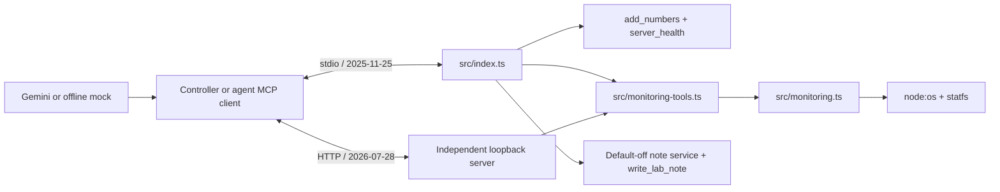

# MCP practical labs: learning guide

## Objectives

Build an understanding of a local MCP server, then apply it to read-only system
monitoring, a restricted default-off note writer, a deterministic operations
controller, a Gemini agent, and local Streamable HTTP. These pages describe the
implementation in this repository, not a separate tutorial application.

Labs 1 and 2 retain their earlier milestone walkthroughs, including historical
tool counts and startup excerpts. Use [Lab 3](lab-03-mcp-security.md) and the
current source for the stdio server's six-tool startup and write policy. Lab 4's
clients permit only three monitoring tools; its independent HTTP server registers
only those three.

| Read next | Focus |
| --- | --- |
| [Lab 1: MCP fundamentals](lab-01-mcp-fundamentals.md) | Registration, validation, stdio, TypeScript, Inspector, and integration testing. |
| [Lab 2: DevOps monitoring](lab-02-devops-monitoring.md) | System identity, memory, filesystem capacity, and safe tool errors. |
| [Lab 3: MCP security and tool permissions](lab-03-mcp-security.md) | Startup permission, safe note creation, quota, auditing, and local trust assumptions. |
| [Lab 4A: MCP operations controller](lab-04a-mcp-operations-controller.md) | Discovery, structured validation, readiness, exit codes, simulations, and cleanup. |
| [Lab 4B: AI agent orchestration](lab-04b-ai-agent-orchestration.md) | Model-selected tools, sanitization, deterministic policy, offline fixtures, and Gemini configuration. |
| [Lab 4C: local Streamable HTTP](lab-04c-streamable-http.md) | Stateless protocol, independent lifecycle, local guards, and transport equivalence. |
| [MCP architecture](concepts/mcp-architecture.md) | Host/client/server roles and the request lifecycle. |
| [Security fundamentals](concepts/security-fundamentals.md) | Input boundaries, permissions, disclosure, and test evidence. |
| [Troubleshooting](troubleshooting.md) | TS18003, TS2769, build configuration, stdio, and metric interpretation. |

## Prerequisites

Use Node.js 24 and npm, and understand basic TypeScript functions, promises, JSON,
and command-line processes. Run project commands from the repository root.

The documentation review observed Node.js `v24.21.0`. Installed versions reported
by `npm ls --depth=0` were client/server SDKs `2.4.0`, Node adapter `2.1.2`,
`@google/genai` `3.4.0`, Zod `4.6.7`, TypeScript `7.0.2`, `tsx` `4.23.15`, and
`@types/node` `26.6.6`. The
[manifest](../package.json) uses version ranges; the [lockfile](../package-lock.json)
records resolved dependencies. Do not substitute older SDK import paths from
unrelated tutorials.

## Architecture

The stdio entry point is [src/index.ts](../src/index.ts). It registers `add_numbers` and
`server_health`, calls the monitoring registration function, initializes the
default-off note service, and connects a `StdioServerTransport`. The current
server advertises six tools, including `write_lab_note` even when writes are disabled.

## Implementation

| File | Responsibility |
| --- | --- |
| [src/index.ts](../src/index.ts) | Server identity, tool registration, startup policy, stdio, and shutdown. |
| [src/monitoring.ts](../src/monitoring.ts) | OS reads, byte calculations, and numeric checks. |
| [src/monitoring-tools.ts](../src/monitoring-tools.ts) | Lab 2 schemas, annotations, readable summaries, and safe failures. |
| [src/note-tools.ts](../src/note-tools.ts) | Content-only contract, public schema adapter, validation-denial auditing, and annotations. |
| [src/lab-notes.ts](../src/lab-notes.ts) | Startup flag, validation, bounded queue, quota, write lifecycle, and cleanup. |
| [src/note-storage.ts](../src/note-storage.ts) | Linux/filesystem scope, secure directories, exclusive flags, and identity checks. |
| [src/note-audit.ts](../src/note-audit.ts) | Private per-session audit file, serialized events, sync, and safe diagnostics. |
| [src/controller/runner.ts](../src/controller/runner.ts), [evaluator.ts](../src/controller/evaluator.ts) | Bounded collection, output validation, and deterministic readiness. |
| [src/agent/runner.ts](../src/agent/runner.ts), [gemini.ts](../src/agent/gemini.ts) | Model-directed calls, sanitized replies, limits, and official SDK integration. |
| [src/http-server.ts](../src/http-server.ts), [controller/http.ts](../src/controller/http.ts) | Stateless SDK handler, loopback policy, HTTP client, and independent lifecycle. |
| [test/mcp.test.mjs](../test/mcp.test.mjs) | Subprocess stdio discovery, addition, health, invalid addition input, and default-off note denial. |
| [test/monitoring.test.mjs](../test/monitoring.test.mjs) | In-memory MCP monitoring calls and deterministic calculation/failure tests. |
| [test/lab-notes.test.mjs](../test/lab-notes.test.mjs) | Note policy, schema, filesystem, quota, queue, auditing, and injected failures. |
| [test/note-stdio.test.mjs](../test/note-stdio.test.mjs) | Enabled startup through stdio, all five prior tools, and a second-process lock check. |
| [tsconfig.json](../tsconfig.json) | Strict source checking and compilation from `src` to `dist`. |

## Commands

| Command | Purpose |
| --- | --- |
| `npm ci` | Install the lockfile's dependencies on a fresh checkout; replaces an existing dependency installation. |
| `npm run dev` | Execute `src/index.ts` with `tsx`; this script does not enable watch mode. |
| `npm run typecheck` | Run `tsc --noEmit`; check without producing JavaScript. |
| `npm run build` | Run `tsc`; emit JavaScript and source maps to `dist` if checking succeeds. |
| `npm start` | Run the existing `dist/index.js`; it does not rebuild. |
| `npm run controller -- --simulate high-memory` | Run a deterministic warning scenario without a server child or OS reads. |
| `npm run agent -- --mock all --simulate healthy "Check readiness"` | Run the offline model with deterministic monitoring. |
| `npm run start:http` | Start the independently managed local HTTP listener on port 3100. |
| `npm test` | Build, then run `node --test test/*.test.mjs`. |

Use the Lab 4 controller/agent or [Inspector](lab-01-mcp-fundamentals.md#commands)
to send protocol messages. Starting a server alone is not a tool invocation.
Use direct Node commands or npm's `--silent` option when capturing pure JSON.

## Verification

This is the shared verification record for these documents. It distinguishes
earlier implementation-session results from this documentation-only review.

| Evidence | Confirmed result | Scope or limitation |
| --- | --- | --- |
| Earlier Lab 2 `npm run typecheck` | Passed. | Checks source selected by `tsconfig.json`; JavaScript test files are outside that selection. |
| Earlier Lab 2 `npm run build` | Passed. | Does not establish behavior on every OS or filesystem. |
| Earlier sandbox `npm test` | Failed at the subprocess stdio test. | Nested Node subprocess output was empty; that restricted run did not validate stdio end to end. |
| Earlier local run outside the sandbox, `npm test` | All six tests passed. | One stdio test plus five monitoring tests, in that execution environment. |
| Completed Lab 3 implementation, `npm run typecheck` and `npm run build` | Passed. | Recorded implementation-session results. |
| Completed Lab 3 implementation, local `npm test` outside the sandbox | **26 passed, zero failed, zero skipped.** | Four test files, including enabled stdio and isolated Linux filesystem tests. |
| Completed Lab 4A implementation | **56 tests passed**; typecheck, build, and whitespace checks passed. | Deterministic controller, simulations, discovery, reporting, and child cleanup. |
| Completed Lab 4B implementation | **80 tests passed**; typecheck, build, and whitespace checks passed. | Adds offline model/API fixtures, request policy, sanitization, budgets, and cleanup. |
| Completed Lab 4C implementation, permitted local environment | **96 tests passed, zero failed, zero skipped**; typecheck, build, and whitespace checks passed. | Adds isolated loopback HTTP tests, protocol checks, transport equivalence, denials, and shutdown. |
| Operator-reported Gemini manual checks | `gemini-3.8-flash` timed out and returned HTTP 503; `gemini-3.5-flash-lite` succeeded in minimal generation and a live MCP agent invocation. | Separate metadata access from generation; no billing, quota, future availability, or tier entitlement verification. |
| Lab 4C manual workflows | Offline and live Gemini-over-HTTP success reported; invalid Origin returned 403; unavailable transport produced exit 2. | Live success is operator-reported, not an automated external-API test. Deterministic tests establish equivalent readiness classifications. |
| Current documentation review | Source, tests, scripts, README, and configuration inspected. | Runtime checks and Inspector were not rerun for this documentation-only change. |
| Inspector | Commands documented from upstream usage. | No successful Inspector session is recorded here; Inspector is not a project dependency. |
| TS18003 | A reported earlier lab setup issue. | Original diagnostic output and failing configuration are not retained; no exact historical cause is claimed. |
| TS2769 | Earlier reported handler inference issue; explicit SDK return annotations are present. | The first inspected copy already had `as const`; its observed compiler blocker was the misspelled `noEmitOnerror` option. |

Test assertions are evidence of the cases they exercise, not a claim of universal
portability, a security audit, or successful behavior in every sandbox. See
[troubleshooting](troubleshooting.md#verification) for the historical Lab 2 cases
and the Lab 3/4 guides for stage-specific coverage. The live outcomes above were
reported by the operator; raw live request logs and exact prompts/timings were
not supplied for this documentation review. No application tests or external
API requests were rerun as part of this documentation-only change.

## Troubleshooting

Start with [the diagnostic guide](troubleshooting.md). Check the working directory,
source selection, build status, and process I/O before changing dependencies.
Keep the sandbox failure and successful local run as separate results.

## Security

The monitoring tools accept no arguments and inspect only local APIs. Disk reads
use `process.cwd()`. Successful output intentionally reveals some host metadata;
read [security fundamentals](concepts/security-fundamentals.md) before connecting
the server to a client. Lab 3 adds local note creation only after explicit startup
enablement; it is a trusted local lab, not a production-grade multi-user
authorization system. Lab 4's HTTP endpoint binds only to `127.0.0.1`, with
Origin/Host checks and request limits but no authentication. Origin validation
is not authentication, and public exposure is outside the trust model. Live
Gemini use sends questions and sanitized metrics externally; never include
credentials in prompts or logs. Offline modes require no Gemini key.

## DevOps relevance

The labs connect protocol contracts, build gates, repeatable verification, and
careful metric interpretation. Lab 4 adds deterministic readiness and bounded
model orchestration over two transports. They still provide individual snapshots;
there is no metrics history, alerting pipeline, dashboard, or deployment automation.

## Lessons learned

Keep executable code as the source of truth. Separate types from runtime
validation, used capacity from available capacity, and recorded success from
untested assumptions. Update these pages when a tool contract or test changes.
