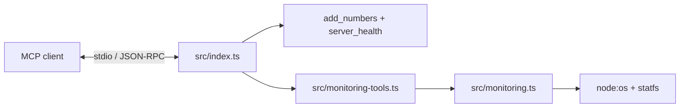

# MCP practical labs: learning guide

## Objectives

Build an understanding of a local MCP server, then apply it to read-only system
monitoring. These pages describe the implementation in this repository, not a
separate tutorial application.

| Read next | Focus |
| --- | --- |
| [Lab 1: MCP fundamentals](lab-01-mcp-fundamentals.md) | Registration, validation, stdio, TypeScript, Inspector, and integration testing. |
| [Lab 2: DevOps monitoring](lab-02-devops-monitoring.md) | System identity, memory, filesystem capacity, and safe tool errors. |
| [MCP architecture](concepts/mcp-architecture.md) | Host/client/server roles and the request lifecycle. |
| [Security fundamentals](concepts/security-fundamentals.md) | Input boundaries, permissions, disclosure, and test evidence. |
| [Troubleshooting](troubleshooting.md) | TS18003, TS2769, build configuration, stdio, and metric interpretation. |

## Prerequisites

Use Node.js 24 and npm, and understand basic TypeScript functions, promises, JSON,
and command-line processes. Run project commands from the repository root.

The documentation review observed Node.js `v24.21.0`. Installed versions reported
by `npm ls --depth=0` were server SDK `2.4.0`, Zod `4.6.7`, TypeScript `7.0.2`,
`tsx` `4.23.15`, and `@types/node` `26.6.6`. The
[manifest](../package.json) uses version ranges; the [lockfile](../package-lock.json)
records resolved dependencies. Do not substitute older SDK import paths from
unrelated tutorials.

## Architecture

The entry point is [src/index.ts](../src/index.ts). It registers `add_numbers` and
`server_health`, calls the monitoring registration function, then connects a
`StdioServerTransport`. The current server advertises five tools.

## Implementation

| File | Responsibility |
| --- | --- |
| [src/index.ts](../src/index.ts) | Server identity, Lab 1 tools, monitoring registration, and stdio startup. |
| [src/monitoring.ts](../src/monitoring.ts) | OS reads, byte calculations, and numeric checks. |
| [src/monitoring-tools.ts](../src/monitoring-tools.ts) | Lab 2 schemas, annotations, readable summaries, and safe failures. |
| [test/mcp.test.mjs](../test/mcp.test.mjs) | Subprocess stdio discovery, addition, health, and invalid addition input. |
| [test/monitoring.test.mjs](../test/monitoring.test.mjs) | In-memory MCP monitoring calls and deterministic calculation/failure tests. |
| [tsconfig.json](../tsconfig.json) | Strict source checking and compilation from `src` to `dist`. |

## Commands

| Command | Purpose |
| --- | --- |
| `npm ci` | Install the lockfile's dependencies on a fresh checkout; replaces an existing dependency installation. |
| `npm run dev` | Execute `src/index.ts` with `tsx`; this script does not enable watch mode. |
| `npm run typecheck` | Run `tsc --noEmit`; check without producing JavaScript. |
| `npm run build` | Run `tsc`; emit JavaScript and source maps to `dist` if checking succeeds. |
| `npm start` | Run the existing `dist/index.js`; it does not rebuild. |
| `npm test` | Build, then run `node --test test/*.test.mjs`. |

Use a real MCP client or [Inspector](lab-01-mcp-fundamentals.md#commands) to send
protocol messages. Starting the server alone is not a tool invocation.

## Verification

This is the shared verification record for these documents. It distinguishes
earlier implementation-session results from this documentation-only review.

| Evidence | Confirmed result | Scope or limitation |
| --- | --- | --- |
| Earlier Lab 2 `npm run typecheck` | Passed. | Checks source selected by `tsconfig.json`; JavaScript test files are outside that selection. |
| Earlier Lab 2 `npm run build` | Passed. | Does not establish behavior on every OS or filesystem. |
| Earlier sandbox `npm test` | Failed at the subprocess stdio test. | Nested Node subprocess output was empty; that restricted run did not validate stdio end to end. |
| Earlier local run outside the sandbox, `npm test` | All six tests passed. | One stdio test plus five monitoring tests, in that execution environment. |
| Current documentation review | Source, tests, scripts, README, configuration, and installed versions inspected. | Runtime checks were not rerun for this documentation-only change. |
| Inspector | Commands documented from upstream usage. | No successful Inspector session is recorded here; Inspector is not a project dependency. |
| TS18003 | A reported earlier lab setup issue. | Original diagnostic output and failing configuration are not retained; no exact historical cause is claimed. |
| TS2769 | Earlier reported handler inference issue; explicit SDK return annotations are present. | The first inspected copy already had `as const`; its observed compiler blocker was the misspelled `noEmitOnerror` option. |

Test assertions are evidence of the cases they exercise, not a claim of universal
portability, a security audit, or successful behavior in every sandbox. See
[troubleshooting](troubleshooting.md#verification) for the six test cases.

## Troubleshooting

Start with [the diagnostic guide](troubleshooting.md). Check the working directory,
source selection, build status, and process I/O before changing dependencies.
Keep the sandbox failure and successful local run as separate results.

## Security

The monitoring tools accept no arguments and inspect only local APIs. Disk reads
use `process.cwd()`. Successful output intentionally reveals some host metadata;
read [security fundamentals](concepts/security-fundamentals.md) before connecting
the server to a client. The repository implements no authentication layer or
remote HTTP endpoint.

## DevOps relevance

The labs connect protocol contracts, build gates, repeatable verification, and
careful metric interpretation. They provide individual snapshots; there is no
metrics history, alerting pipeline, dashboard, or deployment automation.

## Lessons learned

Keep executable code as the source of truth. Separate types from runtime
validation, used capacity from available capacity, and recorded success from
untested assumptions. Update these pages when a tool contract or test changes.
