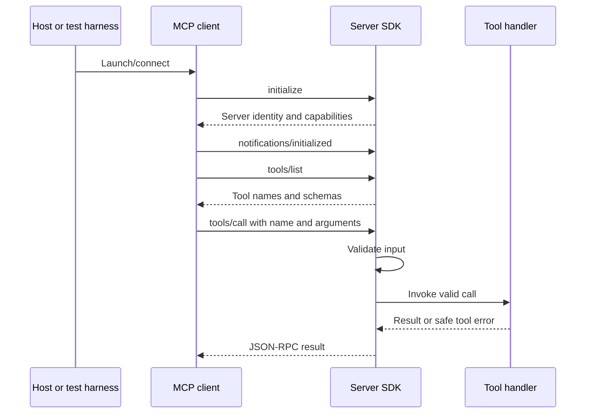

# Concept: MCP architecture

## Objectives

Locate the host, client, server, transport, schema, and handler in a real tool
call. Distinguish what the protocol supports from what this repository implements.

## Prerequisites

Read [Lab 1](../lab-01-mcp-fundamentals.md). Be comfortable reading JSON requests
and asynchronous TypeScript functions.

## Architecture

The host coordinates user interaction and client connections. A client handles
the protocol session with a particular server. The server provides capabilities
through that session. These roles follow the
[MCP architecture specification](https://modelcontextprotocol.io/specification/2025-11-25/architecture).
This repository implements five tools; it does not register prompts or resources.



The sequence reflects the test clients. Invalid arguments produce a validation
result without running the collector. Tool errors (`isError: true`) are distinct
from a JSON-RPC `error` envelope; the tests explicitly inspect the former while
requiring normal calls to have no protocol error envelope.

## Implementation

[src/index.ts](../../src/index.ts) owns server creation and the stdio transport.
[src/monitoring-tools.ts](../../src/monitoring-tools.ts) adds three registrations
to that same server. Each tool registration links a name and contract to code;
registration alone does not execute a tool.

The contract has several layers:

| Layer | Repository example |
| --- | --- |
| Request envelope | `jsonrpc`, `id`, `method`, and `params` in the stdio test. |
| Input contract | `a` and `b` must be numbers; monitoring tools require no arguments. |
| Handler result type | `Promise<CallToolResult>` in Lab 1 and monitoring handlers. |
| Runtime output contract | Lab 2 output schemas for `structuredContent`. |
| Presentation | Text content for readers; JSON text for health; readable monitoring summaries. |

Stdio uses newline-delimited messages through process streams; diagnostics use
stderr. The protocol describes that separation in the
[transport specification](https://modelcontextprotocol.io/specification/2025-11-25/basic/transports#stdio).
The production entry point uses stdio only. The in-memory transport is a test
connection and does not add a second deployed endpoint.

## Commands

```sh
npm run build
node dist/index.js
```

The second command starts the server, which expects MCP messages on stdin. It
does not launch a host UI or automatically invoke tools. Prefer the
[Inspector workflow](../lab-01-mcp-fundamentals.md#optional-mcp-inspector) for
interactive inspection, or `npm test` for automated sessions.

## Verification

[test/mcp.test.mjs](../../test/mcp.test.mjs) implements a sequential stdio client
with correlated request IDs. [test/monitoring.test.mjs](../../test/monitoring.test.mjs)
uses linked SDK in-memory transports and the same initialization/discovery/call
pattern. No client SDK package is added to the dependency manifest.

These tests exercise protocol behavior without an LLM. Their recorded results,
including the sandbox failure and local success, are in the
[learning guide](../README.md#verification).

## Troubleshooting

An empty terminal after startup can mean the server is waiting for input, not
that a tool failed. A malformed stdout line can break framing. A missing tool in
discovery can indicate the wrong executable or stale build. See
[stdio troubleshooting](../troubleshooting.md#stdio-startup-and-discovery).

## Security

The host's user permissions and the server process's OS permissions are separate
from schema validation. JSON structure does not authorize an operation, and a
read-only annotation is descriptive metadata. Read
[security fundamentals](security-fundamentals.md) for the actual boundaries.

## DevOps relevance

Separating transport, protocol contracts, and collection makes failures easier
to locate: launching a process, negotiating a session, discovering a tool, and
obtaining a valid measurement are different checks.

## Lessons learned

Treat tool discovery as an API contract and process streams as part of the
interface. A successful call can be tested with a deterministic client; a full
AI application is not required to verify a server.
