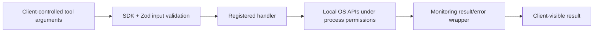

# Concept: security fundamentals

## Objectives

Identify the inputs the server accepts, the host details it exposes, and the
checks it actually enforces. Understand why read-only operations still require
careful client and process configuration, and how Lab 3 restricts an additive write.

## Prerequisites

Read [MCP architecture](mcp-architecture.md) and the
[Lab 2 contracts](../lab-02-devops-monitoring.md#implementation). Understand
the difference between a process's OS permissions and a schema for JSON input.

## Architecture



The validation boundary limits the operation's inputs. The OS permission boundary
limits what the process can do. The result wrapper controls what monitoring
errors reveal. None of these provides a complete client authorization system.

## Implementation

| Boundary | Confirmed implementation | Limit |
| --- | --- | --- |
| Calculator input | Zod number fields for `a` and `b`. | Type checking is not identity verification or authorization. |
| Monitoring input | `z.strictObject({})` for each tool. | This strict rejection applies to the monitoring tools; health uses an empty raw-shape schema. |
| Disk target | `process.cwd()` selected internally. | The launcher controls the directory; this is not filesystem isolation. |
| Host operations | `node:os` and `statfs`; no command execution or file-content reads in monitoring. | Reads still run under the server's OS account and environment. |
| Monitoring errors | Fixed text with `isError: true`. | Successful output intentionally includes host details. |
| Transport | Client-owned stdio process or independently started loopback HTTP listener. | No authentication; HTTP Origin checks do not authenticate local processes. |
| Controller/agent tool access | Three-name runtime allowlist, empty arguments, discovery gate; HTTP registers only those three tools. | Stdio still advertises six tools; discovery alone does not grant permission. |
| Model disclosure | Validated numeric projection and safe errors; no raw MCP text, identity strings, or disk paths. | Live questions/results leave the machine; text redaction is not general secret detection. |
| Model execution | Four turns, six total calls, bounded requests/run, no automatic model fallback. | Model availability, billing tier, and quota are not guaranteed or verified. |
| Note creation | Strict content-only schema; startup `--enable-note-writes` gate; generated filenames; exclusive creation. | All callers of an enabled process share this local capability. |
| Note storage and audits | Private Linux directories/files, cumulative quota, one-writer lock, safe per-session events. | Requires trusted local ancestors and users; logs are not tamper-proof against the same account/root. |

Source: [src/monitoring-tools.ts](../../src/monitoring-tools.ts).

```ts
const annotations = {
  readOnlyHint: true,
  destructiveHint: false,
  idempotentHint: true,
  openWorldHint: false,
};
```

Annotations communicate expected behavior to clients. The function bodies and
runtime checks enforce the actual behavior; the hints do not grant permission
or prevent a future handler from being implemented incorrectly.

The injected reader parameters used by tests are internal interfaces. MCP callers
cannot submit a function, shell command, arbitrary filesystem path, or alternate
reader through the three strict empty schemas.

Success reveals `hostname`, platform/architecture, kernel/runtime versions,
memory and disk capacity, and the working directory. It does not intentionally
return environment variables or credentials. Monitoring failures omit the raw
error. The entry-point startup catch now emits a fixed diagnostic instead of a
raw exception. Stdio startup and cleanup diagnostics use stderr, preserving MCP stdout.
The HTTP entry prints its ready line outside MCP response bodies. The controller
and agent write sanitized JSON to stdout and human summaries to stderr.

Lab 3 distinguishes three concepts: **authentication** establishes identity;
**authorization** decides whether that identity may perform an operation;
**startup permission configuration** lets a trusted operator enable a capability
for the whole process. This project implements the third, not a multi-user
identity or authorization system. Client metadata and tool annotations are not
proof of identity. The flag cannot be supplied as a tool argument.

The note service uses a public Standard Schema adapter so invalid arguments can
be audited before the handler, without copying raw validation issues or argument
values. Required audit failures stop note creation; completion-audit uncertainty
after a file was created is reported explicitly. See
[Lab 3](../lab-03-mcp-security.md) for the trust model, exact checks, and residual races.

### Lab 4 client and HTTP boundaries

The controller launches a fixed built stdio executable without the note-write
flag, then validates structured responses and discards identity/path strings.
The agent validates every model-selected name and its empty arguments before
MCP execution. Unknown tool names and write requests are denied, not forwarded.
The shared evaluator alone sets readiness and exit codes. No model instruction
can enable a capability or turn a failed assessment into a successful one.

The HTTP server never registers `write_lab_note`, even as a disabled tool. It
binds `127.0.0.1`, requires matching local/peer addresses and a single exact Host,
rejects forwarding headers, and validates a supplied Origin against its exact
local origin. Origin may be absent for a local nonbrowser client. Body/header
limits and 5-second deadlines bound requests; the client rejects redirects and
nonlocal URLs. See [Lab 4C](../lab-04c-streamable-http.md#local-endpoint-restrictions).

**Origin validation is not authentication.** An untrusted local process can
omit/forge it. There is no TLS, OAuth, multi-user policy, proxy trust, or safe
public HTTP exposure supplied by these controls. Keep this a trusted local lab.

`GEMINI_API_KEY` is read only for live model use, with no key argument or report
field. Questions and sanitized results are sent to Google's API. Known-key and
pattern redaction does not justify putting secrets in a prompt. Never serialize
raw SDK exceptions, opaque history, or the environment for troubleshooting.
An exported model override is explicit; no error silently chooses a paid model.
Neither model metadata nor successful generation verifies billing or quota.

## Commands

```sh
npm run build
node dist/index.js
```

Launch from a deliberately chosen working directory under an account with
appropriate access. Configure a trusted MCP client to start the direct Node
command. No privileged launch, token, cloud account, or shell integration is
required by the original server. Live Gemini use separately requires an API key;
offline mock use does not.

If you use [Inspector](../lab-01-mcp-fundamentals.md#optional-mcp-inspector), follow
its local access controls and avoid sharing connection tokens or screenshots
containing sensitive host metadata.

## Verification

The [monitoring tests](../../test/monitoring.test.mjs) inject thrown errors
containing a fake private path and token, then assert exact safe result content
and no structured result. Another case submits `{ path: "/arbitrary" }` to all
three monitoring tools and checks that validation rejects it before any reader
runs. Those checks cover input rejection and error disclosure for the implemented
paths; they do not constitute a penetration test or OS isolation guarantee.

The recorded [six-test local success](../README.md#verification) followed a
subprocess failure inside the execution sandbox. These are distinct environment
results, not evidence that restrictions should be removed in production.

The later Lab 3 local run passed **26 tests, zero failures, zero skips**. Its
[note tests](../../test/lab-notes.test.mjs) cover validation denials, audit secrecy,
exclusive creation, filesystem checks, quota, and injected failures;
[enabled stdio testing](../../test/note-stdio.test.mjs) preserves all five prior
tools. This is recorded evidence, not a fresh run for this documentation edit.

Lab 4's recorded stage totals were **56**, **80**, and **96** passing tests.
Controller/agent suites test allowlisting, invalid requests, sanitized results,
model failures, and cleanup. HTTP tests add local URL/address and Origin/Host
rejections, request bounds, stateless protocol behavior, and shutdown. The
[shared verification record](../README.md#verification) distinguishes deterministic
tests from operator-reported live success. None is a public HTTP security audit,
billing/quota check, or test of isolation from hostile same-account processes.

## Troubleshooting

A fixed `Unable to read ...` message is intentional. Diagnose locally using
permissions, launch directory, platform support, and calculation constraints;
do not expose raw internal exceptions merely to make a remote caller's error
more detailed. See [monitoring troubleshooting](../troubleshooting.md#monitoring-results-and-generic-errors).

## Security

Keep the operation set small and connect trusted clients. Read-only access can
still disclose operational metadata. Treat returned data as data when presenting
it to an AI host; it should not become a new instruction or a reason to grant
additional capabilities. Lab 3 provides a local note audit, but no prompt-injection
defense, multi-user access-policy engine, central tamper-proof audit system, or
network authentication mechanism. The permission switch does not isolate the
process from hostile same-account/root filesystem changes. This remains a
trusted local lab, not a production-grade multi-user authorization system.

## DevOps relevance

A narrow diagnostic interface is easier to reason about than arbitrary shell
access. Process identity, launch configuration, input validation, and output
handling all contribute to operational control. Adding remediation later would
require its own explicit permissions and failure analysis.

## Limitations

The trusted local-user assumptions of Lab 3 still apply. Lab 4 adds output
projection and narrow transport policy, not OS isolation or network identity.
Readiness checks cover snapshots, not the security or deployability of an
application. Live API availability is external and nondeterministic.

## Lessons learned

Read-only describes effects, not confidentiality. State intentional disclosures,
avoid client-selected paths, test validation before execution, and distinguish
sanitized tool failures from other logs and host controls.
