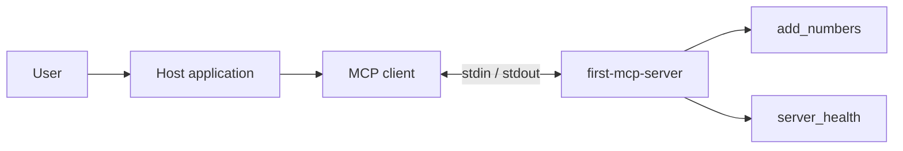

# Lab 1: MCP fundamentals

## Objectives

Explain host/client/server roles, register two tools, validate inputs with Zod,
return correctly typed MCP results, and verify the stdio connection. Understand
the lab's TS18003 and TS2769 troubleshooting history without treating missing
historical evidence as a reproduced diagnosis.

## Prerequisites

Use the [learning guide's environment](README.md#prerequisites): Node.js 24,
TypeScript 7, server SDK 2.4.0, and Zod 4. Read
[src/index.ts](../src/index.ts), [package.json](../package.json), and
[tsconfig.json](../tsconfig.json). The current project includes Lab 2 as well;
do not remove its three tools to follow this lesson.

## Architecture

A host is the application coordinating user interaction and tool access. Its MCP
client maintains the protocol connection to this server. The server registers
capabilities and executes validated calls. The
[MCP architecture specification](https://modelcontextprotocol.io/specification/2025-11-25/architecture)
defines those roles; this repository supplies the server and test clients, not a
full AI host or model.



The diagram highlights the two Lab 1 tools. Discovery in the completed repository
also includes the three monitoring tools. With stdio, the client launches a
child process; requests arrive on stdin and responses leave on stdout. Newlines
separate JSON-RPC messages. Logging belongs on stderr, as required by the
[stdio transport specification](https://modelcontextprotocol.io/specification/2025-11-25/basic/transports#stdio).
There is no listening HTTP port in this server.

## Implementation

### Registration and validation

Registration associates a name, a description, an input schema, and a handler.
Source: [src/index.ts](../src/index.ts).

```ts
server.registerTool(
  "add_numbers",
  {
    description: "Add two numbers together",
    inputSchema: {
      a: z.number(),
      b: z.number(),
    },
  },
  async ({ a, b }): Promise<CallToolResult> => {
    const result = a + b;
```

This is a source excerpt, not a complete standalone program. Zod supplies runtime
validation and TypeScript inference for `a` and `b`. TypeScript checks code during
development; it cannot validate an incoming JSON value at runtime. The test sends
`a: "2"` and verifies an `isError: true` validation result rather than numeric
coercion.

`server_health` accepts an empty raw-shape schema and returns JSON text containing
`status: "healthy"` and `Math.floor(process.uptime())` as `uptimeSeconds`. This is
process uptime and a simple status response, not a downstream dependency probe.
The Lab 1 tools do not advertise output schemas or return `structuredContent`.

### Structured calls versus structured output

An illustrative wire request after initialization is:

```json
{"jsonrpc":"2.0","id":3,"method":"tools/call","params":{"name":"add_numbers","arguments":{"a":2,"b":3}}}
```

The request structure names a tool and gives it JSON arguments. For these inputs,
the handler's text is `The sum is 5`. That is a structured protocol call whose
result contains text. Lab 2 additionally returns a machine-readable result object
through `structuredContent`.

### Transport and compiler configuration

Source: [src/index.ts](../src/index.ts).

```ts
  const transport = new StdioServerTransport();

  await server.connect(transport);

  console.error("MCP server connected through stdio");
```

The project uses ES modules (`"type": "module"`), `NodeNext` module settings,
`ES2022` output, `strict: true`, and `noUncheckedIndexedAccess: true`. Its
`include` selects `src/**/*.ts`; `rootDir` is `src` and `outDir` is `dist`.
The correctly spelled `noEmitOnError: true` blocks new compiler output on errors.
It does not remove old files from `dist`.

Both Lab 1 handlers explicitly return `Promise<CallToolResult>`. This gives the
returned content a contextual SDK type, preserving the required `"text"`
discriminator and checking the rest of the result.

## Commands

Run these from the repository root after installing dependencies:

```sh
npm run typecheck
npm run build
npm test
```

These check source types, build the executable, and build again before running
the two JavaScript test files. `npm run dev` runs the TypeScript source with
`tsx`; `npm start` runs the last compiled output. For a host configuration,
prefer the direct executable command `node /absolute/path/to/project/dist/index.js`
so npm lifecycle banners cannot enter the MCP stdout stream. Set the launch
working directory explicitly when the host supports it.

### Optional MCP Inspector

Build first, then launch an interactive inspection session:

```sh
npx @modelcontextprotocol/inspector node dist/index.js
```

Use its tool discovery view to inspect schemas. Invoke `add_numbers` with
`{"a":2,"b":3}`, then with `{"a":"2","b":3}`, and call `server_health` with `{}`.
Observe the result content and validation error separately.

For command-line discovery, upstream documents:

```sh
npx @modelcontextprotocol/inspector --cli node dist/index.js --method tools/list
```

These are optional commands, not recorded successful executions for this lab.
`npx` may download Inspector and requires registry access if it is not cached;
Inspector is not added to this project's dependencies. Check the
[official Inspector usage](https://github.com/modelcontextprotocol/inspector)
and [CLI examples](https://github.com/modelcontextprotocol/inspector/blob/main/clients/cli/README.md)
for the version you run. Keep Inspector access local and treat its connection
credentials as sensitive.

## Verification

[test/mcp.test.mjs](../test/mcp.test.mjs) launches `dist/index.js` using the current
Node executable and a fixed repository working directory. It performs
`initialize`, sends `notifications/initialized`, discovers all five tools,
calls addition and health, and checks invalid addition input. It matches response
IDs, skips server notifications, captures stderr for failure diagnostics, and
registers cleanup before assertions. Its test timeout is 30 seconds.

The test implements a small sequential JSON-RPC client directly; it does not use
an installed MCP client package or an LLM. Monitoring tool invocation is covered
separately with an SDK in-memory transport in Lab 2.

The earlier sandbox subprocess test failed; the earlier local run outside the
sandbox passed all six tests. See the [shared verification record](README.md#verification).
This documentation change does not claim a fresh test run or a completed
Inspector session.

## Troubleshooting

### TS18003: no compiler inputs

TS18003 means the compiler found no input files for the selected configuration.
This is a reported lab setup experience, but its original log and failing
configuration are not retained in the inspected repository. A specific old
filename or directory mistake cannot be established from the current code.

The current configuration selects `src/**/*.ts`, and `src/index.ts` exists.
Confirm the command's working directory, selected configuration, saved source
files, and include/exclude patterns before changing compiler options. `rootDir`
controls the source root; it does not select input files. See
[the diagnostic commands](troubleshooting.md#ts18003-no-inputs-were-found).

### TS2769: widened content discriminator

The original reported health-handler issue was a `content[].type` inferred as
`string` where MCP expects the literal `"text"`. Without sufficient contextual
typing, mutable object properties can widen, making the callback incompatible
with `registerTool` overloads.

The first inspected copy already contained `"text" as const`; the compiler then
reported TS5025 for `noEmitOnerror`. The applied solution used explicit
`Promise<CallToolResult>` return types for both handlers, removed the local
assertion, and corrected the option to `noEmitOnError`. It used no `any`, ignored
diagnostics, or relaxed strictness. See [the detailed history](troubleshooting.md#ts2769-tool-result-typing).

## Security

Zod rejects incorrectly typed calculator arguments before the handler runs.
Stdio remains a protocol channel, not a shell prompt. This server implements no
shell execution or authentication layer. A client able to launch it can request
its exposed tools under the process's OS permissions. Read
[security fundamentals](concepts/security-fundamentals.md), especially the
distinction between runtime validation and authorization.

## DevOps relevance

The typecheck/build/test sequence separates contract errors, compilation errors,
and protocol behavior. Correct stderr logging preserves parsable stdout.
Repeatable discovery and negative-input testing make client/server integration
observable without relying on a model's natural-language interpretation.

## Lessons learned

Use explicit SDK result types where inference is ambiguous. Inspect the selected
files before diagnosing a compiler setup issue. Treat the transport as part of
the contract, and report environment-specific test failures alongside successful
runs rather than replacing one with the other.
