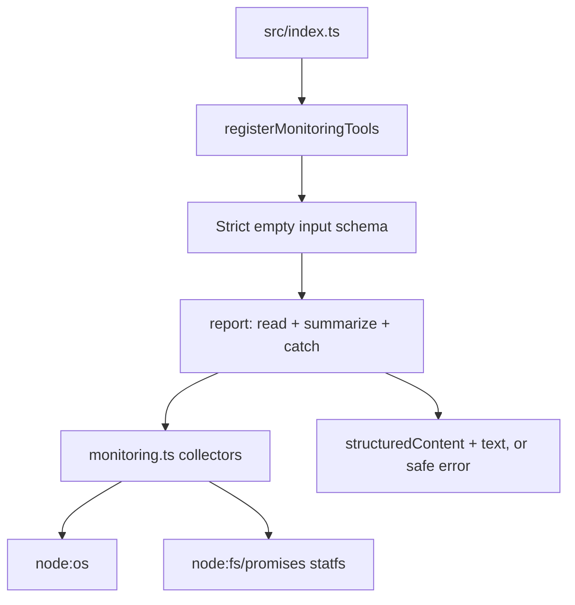

# Lab 2: read-only DevOps monitoring

## Objectives

Expose system identity, memory, and filesystem capacity as three MCP tools.
Explain their units and accounting rules, distinguish structured output from
readable summaries, and test failure paths without changing the machine.

## Prerequisites

Complete [Lab 1](lab-01-mcp-fundamentals.md). Understand promises, bytes,
percentages, and the server process's working directory. Read
[src/monitoring.ts](../src/monitoring.ts) and
[src/monitoring-tools.ts](../src/monitoring-tools.ts). No external service,
credentials, shell utility, or additional dependency is required by these tools.

## Architecture



Registration owns the MCP contract; collectors own host reads and calculations.
Tests can inject readers through ordinary function parameters. Those parameters
are internal TypeScript/JavaScript interfaces, not tool arguments exposed to
clients. All three tool input schemas are `z.strictObject({})`.

## Implementation

### `system_info`

Source: [src/monitoring.ts](../src/monitoring.ts).

```ts
export function systemInfo() {
  return {
    platform: os.platform(),
    architecture: os.arch(),
    kernelRelease: os.release(),
    hostname: os.hostname(),
    nodeVersion: process.version,
  };
}
```

The `node:os` functions describe the executing environment. `nodeVersion` is
the running process's version, not a version read from `package.json`.
No environment variables, usernames, home directories, or network interfaces
are returned by this tool.

### `memory_usage`

`os.totalmem()` and `os.freemem()` return system memory in bytes. The collector
checks that readings are nonnegative safe integers and calculates:

| Field | Meaning |
| --- | --- |
| `totalBytes` | `os.totalmem()` |
| `freeBytes` | `os.freemem()` |
| `usedBytes` | `totalBytes - freeBytes` |
| `utilizationPercent` | `usedBytes / totalBytes * 100`, or zero when total is zero |

On Linux, total minus free includes reclaimable caches and buffers. It is not
application-only memory or a calculation using `MemAvailable`. High utilization
by this definition alone does not establish memory pressure. Both the tool
description and text summary explain the cache caveat. These are OS memory
readings, not `process.memoryUsage()` metrics. See the
[Node OS API](https://nodejs.org/api/os.html#osfreemem).

### `disk_usage`

Source: [src/monitoring.ts](../src/monitoring.ts).

```ts
export async function diskUsage(
  read: ReadDiskStats = (path) => statfs(path, { bigint: true }),
) {
  const path = process.cwd();
  const stats = await read(path);
```

The inspected path is fixed by the server's launch environment. `process.cwd()`
is the process working directory, not the location of `dist/index.js`. The
collector reads the filesystem containing that path. It does not calculate the
project directory's size or accept a client-supplied path.

The implementation uses `statfs` from `node:fs/promises`, requesting bigint
statistics and multiplying by the reported `bsize`. It validates the block
counts, then converts byte counts to JSON-compatible numbers only within the
safe-integer range. The [Node statfs API](https://nodejs.org/api/fs.html#class-fsstatfs)
documents the distinction between free and available blocks.

| Output | Calculation | Interpretation |
| --- | --- | --- |
| `path` | `process.cwd()` | Directory identifying the inspected filesystem. |
| `totalBytes` | `blocks * bsize` | Filesystem capacity. |
| `availableBytes` | `max(0, bavail) * bsize` | Free space available to unprivileged users. |
| `usedBytes` | `(blocks - bfree) * bsize` | Space used after subtracting all free blocks. |
| `utilizationPercent` | `usedBytes / totalBytes * 100` | Used fraction of total; zero when total is zero. |

`bfree` includes all free blocks, including reserved blocks. `bavail` describes
free blocks available to unprivileged users. Reserved free blocks are excluded
from available space but are not allocated space. Consequently,
`totalBytes - availableBytes` can exceed `usedBytes`.

The deterministic test uses `bsize = 4`, `blocks = 100`, `bfree = 30`, and
`bavail = 20`. It expects total 400 bytes, used 280 bytes, available 80 bytes,
and utilization 70%. The remaining 40 bytes illustrate reserved free capacity.
These are fixture values, not observed host metrics.

Negative `bavail` is clamped to zero. Invalid statistics and byte counts exceeding
`Number.MAX_SAFE_INTEGER` fail instead of silently returning imprecise numbers.
This percentage may differ from a `df` percentage using
`used / (used + available)`. The tool does not separately determine user quotas.

### Output schemas and safe failures

Monitoring registration declares output schemas: identity fields are strings,
byte fields are nonnegative integers, and utilization is bounded from 0 to 100.
Successful results carry the object and a readable summary. Source:
[src/monitoring-tools.ts](../src/monitoring-tools.ts).

```ts
  try {
    const value = await read();
    return {
      structuredContent: value,
      content: [{ type: "text", text: summary(value) }],
    };
  } catch {
    // OS errors can contain paths or other host details. Keep them off the wire.
    return { isError: true, content: [{ type: "text", text: failureMessage }] };
  }
```

The three fixed failure messages are `Unable to read system information.`,
`Unable to read memory usage.`, and `Unable to read disk usage.`. Failed reads
return no partial structured metrics and no raw error message or stack trace.
Input-validation errors are handled separately by the SDK before collection.

## Commands

```sh
npm run typecheck
npm run build
npm test
```

For a focused run after building:

```sh
node --test test/monitoring.test.mjs
```

The focused suite uses an in-memory transport, not the stdio subprocess. A
restricted test runner may itself use subprocesses. For manual discovery and
invocation, use the [Inspector workflow](lab-01-mcp-fundamentals.md#optional-mcp-inspector)
and call each monitoring tool with `{}`. Read `structuredContent` for numeric
processing; the displayed percentage in text is rounded to two decimals.

## Verification

[test/monitoring.test.mjs](../test/monitoring.test.mjs) covers real MCP discovery
and invocation using `InMemoryTransport.createLinkedPair()`. It verifies
read-only annotations, output schemas, rejection of extra input fields, identity
field types, numeric bounds, and relationships between fields. It does not assert
exact live memory or disk values.

Injected fixtures exercise zero capacity, invalid memory readings, reserved disk
blocks, negative availability, invalid block counts, oversized byte counts, and
thrown reader errors. A failure fixture includes a fake private path/token and
checks that the result contains only the fixed safe message. Client path tests
also check that no collector ran.

The earlier local run outside the sandbox passed all six tests, including the
existing stdio integration test. The earlier sandbox run failed that subprocess
test. See the [verification record](README.md#verification); no runtime checks
were rerun for this documentation-only change. Neither run proves every platform,
filesystem, container limit, or OS-specific failure behavior.

## Troubleshooting

An unexpected disk path usually requires checking the client's launch working
directory. The absolute executable path does not set that directory. Different
memory or disk percentages may follow from different accounting definitions,
sampling times, or container views. A generic tool error can also reflect an
unsupported filesystem read or an unsafe numeric range. Follow
[metric troubleshooting](troubleshooting.md#monitoring-results-and-generic-errors)
without exposing raw host errors to a client.

## Security

No tool executes a shell command, writes files, accepts a path, or reads file
contents. The three strict input schemas reject unexpected arguments. The fixed
working directory is a deliberate boundary, not an OS sandbox. Success reveals
hostname, runtime/kernel versions, capacity, and the inspected path. Choose a
trusted client and suitable working directory; see
[security fundamentals](concepts/security-fundamentals.md).

## DevOps relevance

These snapshots demonstrate an assistant-facing diagnostic interface with
explicit units and a small permission surface. Correct cache and reserved-block
interpretation matters when investigating capacity. The implementation has no
sampling schedule, metric retention, alerts, remediation, or process control.
Those are possible later design topics, not current capabilities.

## Lessons learned

Separate collection from protocol registration so failure behavior can be tested
deterministically. Name the measurement formula as part of the contract. Preserve
safe integer arithmetic, validate runtime input, and keep errors useful without
returning unnecessary host details.
