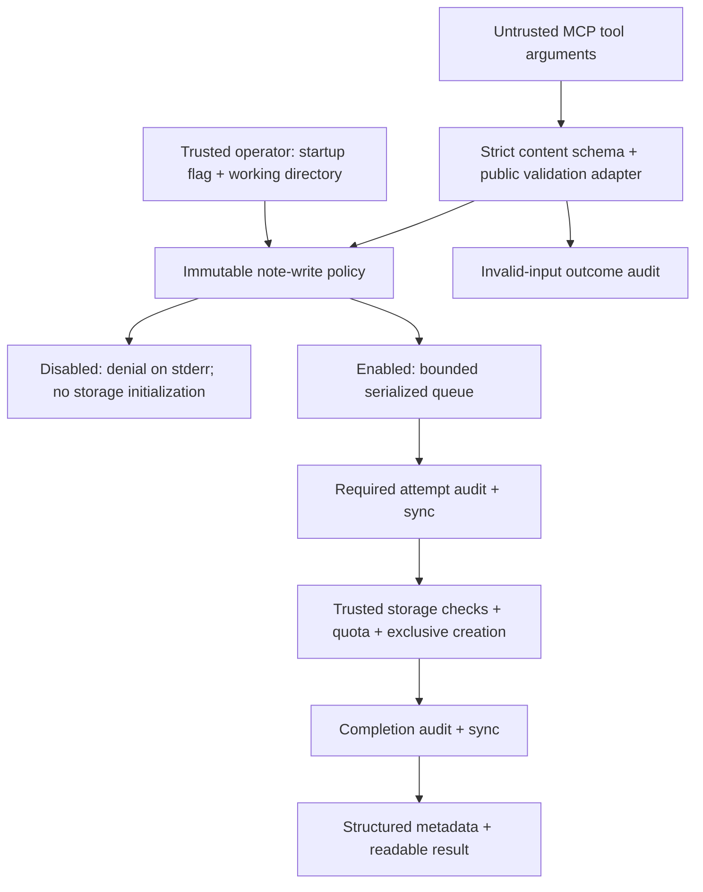

# Lab 3: MCP security and tool permissions

## Objectives

Add a narrowly scoped write capability to the five existing tools, then explain
its validation, storage, audit, and failure boundaries. Distinguish an operator's
startup permission from user authentication and authorization.

This is a **trusted local lab, not a production-grade multi-user authorization
system**. The guide describes the completed implementation. Manual procedures
below are checks to perform, not a claim that an Inspector session was completed.

## Prerequisites

Complete [Lab 1](lab-01-mcp-fundamentals.md) and
[Lab 2](lab-02-devops-monitoring.md). Use the existing Node.js 24, TypeScript 7,
server SDK 2.4.0, and Zod 4 project. Run commands from the repository root under
the intended OS account. Use non-sensitive sample notes for manual testing.

Enabled writes require Linux, usable no-follow/directory filesystem constants,
and a filesystem type explicitly allowlisted in
[src/note-storage.ts](../src/note-storage.ts): ext-family (`0xef53`), XFS
(`0x58465342`), Btrfs (`0x9123683e`), or tmpfs (`0x01021994`). Network filesystems,
FUSE, overlay, and other unlisted types are rejected; there is no weaker fallback.
tmpfs storage is volatile. Disabled mode does not initialize or inspect storage.

The launch directory must be canonical, owned by the effective user, and not
group/world writable. Ancestors must be directories owned by root or the same
user; writable ancestors are rejected except sticky parent directories. These
checks assume trusted ancestor owners and local users. They do not make a
filesystem-type allowlist proof of every mount's security properties.

## Architecture



The client controls note content, but not policy, root directories, filename,
audit destination, or injected readers. The OS account controls filesystem access.
The schema, policy gate, and filesystem are separate trust boundaries.

### Threat model

| Asset / scenario | Implemented control | Residual risk |
| --- | --- | --- |
| Files outside the notes directory; traversal attempts | No filename/path argument; generated basename; fixed launch-relative root. | Hostile local directory replacement can race path-based checks. |
| Existing files; overwrite, symlink, or collision | Private directories, exclusive no-follow creation, regular-file/link checks. | Trust in the local filesystem and same-account/root actors remains necessary. |
| Note confidentiality; audit or error disclosure | Allowlisted metadata, fixed errors, no contents/hashes/raw arguments/absolute paths/raw exceptions in audits. | Clients already know submitted content; local account/root and backups may access files. |
| Storage and process availability; flooding | 8 KiB per note, 10 MiB cumulative content quota, bounded queues, transport buffer limit. | File count, metadata, audit growth, and denial traffic are not covered by the content quota. |
| Audit integrity; unavailable sink or crash | Private session file, serialized writes and sync, fail-closed behavior. | No atomic transaction across note/audit files, tamper-proof storage, or power-loss guarantee. |

## Implementation

### Tool contract and code organization

| File | Responsibility |
| --- | --- |
| [src/index.ts](../src/index.ts) | Startup configuration, registration, stdio, signals, and shutdown cleanup. |
| [src/note-tools.ts](../src/note-tools.ts) | Input/output schemas, validation-denial auditing, and annotations. |
| [src/lab-notes.ts](../src/lab-notes.ts) | Content validation, policy, queue, quota, write lifecycle, and safe results. |
| [src/note-storage.ts](../src/note-storage.ts) | Trusted Linux scope, directories, file checks, and exclusive flags. |
| [src/note-audit.ts](../src/note-audit.ts) | Private session audit, serialized records, sync, and fallback diagnostics. |

`write_lab_note` is always registered, including when writes are disabled. Its
only accepted argument is `content`. Source: [src/note-tools.ts](../src/note-tools.ts).

```ts
const input = z.strictObject({
  content: z.string().min(1).max(8192).refine(validNoteContent, "Invalid plain-text note content"),
});
```

Unknown properties such as `path`, `filename`, `directory`, `overwrite`, or
`--enable-note-writes` are rejected. This is stricter than ignoring those fields.
The output schema describes `noteId`, `filename`, and `bytesWritten`. Success
returns these through `structuredContent` and a readable summary without echoing
the note. Failure uses `isError: true` and text; no successful output object is
promised for a failure.

Annotations are `readOnlyHint: false`, `destructiveHint: false` (additive),
`idempotentHint: false`, and `openWorldHint: false`. They describe behavior; the
implementation enforces it. Repeating a successful request creates a different
note, so automatic retries can duplicate content.

### Startup policy, authentication, and authorization

Source: [src/lab-notes.ts](../src/lab-notes.ts).

```ts
export function noteWritesEnabled(args: readonly string[]): boolean {
  if (args.some((arg) => arg !== "--enable-note-writes") || args.length > 1) {
    throw new NoteFailure("invalid_startup_configuration");
  }
  return args.length === 1;
}
```

No arguments means disabled. Exactly one `--enable-note-writes` enables the
startup checks. Unknown, duplicate, or value-bearing flags such as
`--enable-note-writes=false` fail startup. There is no environment-variable,
tool-argument, or runtime policy toggle. Internal test options are not startup
configuration exposed to a client.

Authentication establishes who a caller is. Authorization decides which actions
that identity may perform. This startup flag instead allows a trusted operator to
enable a capability for the entire server process. Every connected caller shares
that setting; MCP client metadata is not a verified identity. An "authorized"
manual creation here means operator-enabled creation, not per-user authorization.

### Bytes, Unicode, and plain text

Source: [src/lab-notes.ts](../src/lab-notes.ts).

```ts
export function validNoteContent(content: string): boolean {
  const bytes = Buffer.byteLength(content, "utf8");
  return bytes >= 1 && bytes <= 8192 && Buffer.from(content, "utf8").toString("utf8") === content &&
    !/[\u0000-\u0008\u000b\u000c\u000e-\u001f\u007f-\u009f]/u.test(content);
}
```

The effective limit is **1–8192 UTF-8 bytes**, not 8192 visible characters. For
example, 4096 `é` characters or 2048 `😀` characters occupy exactly 8192 bytes.
The round trip rejects malformed Unicode such as unpaired UTF-16 surrogates.
NUL, unsupported C0 controls, DEL, and C1 controls are rejected; tab, LF, and CR
are permitted. Content is preserved without Unicode normalization. Whitespace-only
nonempty content is allowed. Validation is repeated at the service boundary.

Plain text is stored as data. Shell-like text is not executed, and a `.txt`
extension is not a content sanitizer or protection against future unsafe rendering.

### Fixed directories, filenames, and exclusive creation

The server captures `process.cwd()` for its storage root. It uses only:

```text
lab-data/
  .note-writer.lock
  notes/note-<randomUUID>.txt
  audit/session-<randomUUID>.jsonl
```

The generated filenames use `node:crypto`'s `randomUUID()` and are checked against
the implementation's version-4 UUID filename pattern. No caller-selected name
is joined to a filesystem path. The script's location does not choose storage:
an absolute executable path still uses the configured working directory.

Initialization uses individual `mkdir` calls, then `lstat` checks, not unchecked
recursive creation or automatic permission repair. Existing symlinks, wrong
types/owners/modes, and directories on another device fail. `lab-data`, `notes`,
and `audit` must have mode `0700`; notes, audit files, and the lock must be owned
by the effective user, regular files, mode `0600`, and have one hard link. Creation
modes are subject to umask, and the actual modes must still satisfy the checks.

Source: [src/note-storage.ts](../src/note-storage.ts).

```ts
export function exclusiveFlags(): number {
  return constants.O_WRONLY | constants.O_CREAT | constants.O_EXCL | constants.O_NOFOLLOW;
}
```

Opening the destination creates it exclusively; an existing destination fails
without truncation or replacement. Bytes are written through the returned handle,
synced, and closed. Directory device/inode identity, ownership, and mode are
rechecked during operations; audit file attributes are also rechecked.

On an ordinary write failure, cleanup closes the handle and removes only a
destination whose identity matches the newly created file. If cleanup cannot be
confirmed, the response warns that a partial note may remain and further writes
are disabled. Path checks and `O_NOFOLLOW` do not provide race-free protection for
every ancestor: a hostile same-account/root process can bypass the trust model.
There is no directory-relative kernel sandbox here.

### Quota, queue, lock, and crashes

The cumulative limit is `10 * 1024 * 1024` bytes (10 MiB). The service scans stored
note sizes at startup and before creation, including partial notes from previous
sessions. Unexpected names, symlinks, directories, unsafe file modes/owners, or
multiple hard links in `notes/` fail storage checks. It does not silently skip
unsafe entries or reset usage on restart.

At most 16 accepted writes, including the running operation, can be pending.
They execute serially; excess calls receive an audited `busy` denial when the
audit sink is available. An exclusively created `.note-writer.lock` excludes a
second cooperating writer process, keeping quota checks serialized across sessions.
Shutdown waits for queued writes, closes auditing, and safely removes its own lock.

A crash can leave a lock and a partial note. No automatic stale-lock removal or
recovery occurs. Inspect locally and confirm no writer is active before any
operator-controlled recovery. The content quota excludes audits, directory
entries, allocation overhead, and inode usage. There is no audit retention policy.

### Auditing, correlation, and fail-closed behavior

Enabled sessions create private `session-<UUID>.jsonl` files under `lab-data/audit/`.
Normal records contain a timestamp, fixed tool name, server-generated
`operationId`, event type, and appropriate outcome/reason fields. Successful
completion also records the generated `noteId`. Operation IDs correlate a queued
write's `attempt` with its `outcome`; they are not identities or authorization tokens.

Queued writes require an attempt audit and sync before creating a note, then a
completion audit and sync before reporting success. Policy, validation, overload,
and closing denials can have a standalone `outcome: denied` record without a
preceding attempt. Reasons are fixed codes such as `invalid_input`,
`writes_disabled`, `busy`, and `quota_exceeded`.

The SDK validates tool input before calling the handler. The public
`StandardSchemaWithJSON` adapter preserves Zod's schema conversion and wraps
validation to call `notes.deny("invalid_input")`. It returns a safe message
instead of raw Zod issues containing caller-controlled keys. No dependency
internals are patched. Malformed JSON/JSON-RPC or transport-limit rejections
before this adapter are not guaranteed to produce note-level audit records.

Audit events contain no note contents, content hashes, raw arguments, absolute
paths, or raw exception messages. Writes are serialized and synced; audit backlog
is bounded at 64 pending records. Exhausting that backlog or a required write,
sync, or safety check fails closed. Disabled mode creates no storage directories
and sends denial diagnostics to stderr. stderr also carries human-readable
startup/cleanup diagnostics; it is not an all-JSON audit file.

If an operation's required attempt audit fails, that operation creates no note.
An audit failure is not an atomic cancellation of work already in progress. If a fully
written note's completion audit cannot be confirmed, the tool reports that
uncertainty with an operation ID, emits a best-effort safe stderr diagnostic, and
disables further writes. **Do not retry automatically.** Audits and note creation
are separate filesystem operations, not one transaction. Files are synced, but
there is no guarantee of atomic recovery or survival of every power-loss scenario.

## Commands

| Command | Purpose and side effect |
| --- | --- |
| `npm run typecheck` | Check selected TypeScript source without emitting output. |
| `npm run build` | Compile `src` to `dist`; required before launching compiled code. |
| `npm test` | Build, then run all four `test/*.test.mjs` files. |
| `node dist/index.js` | Start stdio with note creation disabled. |
| `node dist/index.js --enable-note-writes` | Start enabled on trusted supported storage; initializes private data/audit directories and the lock. |

The runtime checks above passed during implementation; they are not rerun as part
of this documentation-only edit. Starting a server without an MCP client does not
invoke a tool. stdout is reserved for protocol messages; use a direct Node command
in clients rather than wrappers that print banners to stdout.

### MCP Inspector setup

Build in the repository root. Run **one session at a time**, disconnecting and
stopping its server before starting another enabled session:

```sh
npm run build
npx @modelcontextprotocol/inspector node dist/index.js
```

For the interactive web Inspector with writes enabled, forward the startup flag
as a separate server argument:

```sh
npx @modelcontextprotocol/inspector node dist/index.js -- --enable-note-writes
```

Here `--` belongs to Inspector's web command-line parsing; do not pass a bare
`--` to the Node server. If configuring the connection in a UI or client config,
keep `command` and argument tokens separate. This illustrative entry is not a
configuration file added to the repository; replace both absolute paths:

```json
{
  "mcpServers": {
    "lab3-enabled": {
      "type": "stdio",
      "command": "node",
      "args": ["/absolute/path/to/first-mcp-server/dist/index.js", "--enable-note-writes"],
      "cwd": "/absolute/path/to/first-mcp-server"
    }
  }
}
```

For disabled mode, omit the flag element. Do not combine script and flag into one
quoted argument, put the flag in `command`, or send it in the tool's JSON input.
Keep Inspector's own access controls enabled and its connection credentials private.
`npx` may download Inspector; it is not a project dependency.

Inspector command syntax follows the upstream
[server configuration and argument-boundary documentation](https://github.com/modelcontextprotocol/inspector/blob/main/docs/mcp-server-configuration.md)
and [CLI examples](https://github.com/modelcontextprotocol/inspector/blob/main/clients/cli/README.md).
Web and CLI separator rules differ; do not transpose them. The CLI examples
below use no separator. These commands are documented procedures, not recorded
Inspector executions; behavior/layout can depend on the installed Inspector version.

## Verification

### Manual verification

Perform these checks with non-sensitive data. They create real notes when enabled;
they are not executed by this documentation update. Shell inspection commands
below run in a separate operator terminal, never inside the MCP server.

1. **Default-off denial.** Connect without the enable flag and discover six tools.
   Call `write_lab_note` with `{"content":"Lab 3 disabled check"}`. Expect
   `isError: true` and the fixed writes-disabled message, plus a stderr denial
   with reason `writes_disabled`. In a fresh checkout, `lab-data/` must remain
   absent; existing data must remain untouched. Visibility does not imply permission.

2. **Operator-enabled creation.** Stop that session, restart with the separate
   enable argument, and call `{"content":"Lab 3 manual note"}`. Expect
   `structuredContent.noteId`, a generated `note-<UUID>.txt` filename, and
   `bytesWritten`. Confirm the returned filename exists inside `lab-data/notes/`.
   Repeating the request creates another file; it is not an overwrite operation.

3. **Permissions and ownership.** While the enabled server is alive, run these
   read-only GNU/Linux checks from the same repository working directory:

   ```sh
   id -u
   stat -c '%a %u %h %F %n' lab-data lab-data/notes lab-data/audit
   stat -c '%a %u %h %F %n' lab-data/.note-writer.lock lab-data/notes/note-*.txt lab-data/audit/session-*.jsonl
   ```

   Expect directory mode `700`, file mode `600`, and your effective UID. Private
   files should have one hard link. The lock exists only during an enabled session
   or after an unclean shutdown. Do not change modes to force a test to pass.

4. **Path/unknown-field rejection.** Record the file listing before and after a
   rejected call:

   ```sh
   find lab-data/notes -maxdepth 1 -type f -name 'note-*.txt' -print
   ```

   Submit `{"content":"Rejected path check","path":"../escape.txt"}` through
   a raw argument editor if available. Expect a validation error, no new note,
   and an `invalid_input` outcome audit. A schema-generated form may prevent
   unknown fields; use the CLI alternative below after stopping the UI server.

5. **Malformed arguments and byte boundaries.** Submit these raw JSON argument
   objects individually; each must fail without adding a note:

   ```json
   {"content":"bad\u0000note"}
   ```

   ```json
   {"content":"\ud800"}
   ```

   ```json
   {"content":42}
   ```

   Also try `{}`, an empty string as content, and an unknown `filename` field.
   For a boundary payload, this local command prints JSON to paste into the raw
   editor; 4096 `é` characters should succeed, while 4097 should fail:

   ```sh
   node -e 'console.log(JSON.stringify({content: "é".repeat(4096)}))'
   ```

   Invalid JSON syntax can be rejected by Inspector or the protocol parser before
   the tool is reached; that is different from an audited argument-validation denial.

6. **Audit records and secrecy.** Inspect metadata only, in your operator terminal:

   ```sh
   find lab-data/audit -maxdepth 1 -type f -name 'session-*.jsonl' -exec cat -- {} +
   grep -F -- 'Lab 3 manual note' lab-data/audit/session-*.jsonl
   ```

   Find a correlated `attempt` and `outcome: created` with the same `operationId`,
   and standalone `outcome: denied` / `reason: invalid_input` records. The grep
   should print nothing and exit `1` when the sample text is absent. Check that
   events contain only the documented metadata, not note text, raw arguments, or
   absolute paths. Do not share unrelated audit records or sensitive local output.

For repeatable CLI calls, run these individually from the project root with any
interactive enabled server stopped. Denials may give Inspector a nonzero exit:

```sh
npx @modelcontextprotocol/inspector --cli node dist/index.js \
  --method tools/call --tool-name write_lab_note \
  --tool-arg 'content=Lab 3 disabled check'

npx @modelcontextprotocol/inspector --cli node dist/index.js \
  --enable-note-writes \
  --method tools/call --tool-name write_lab_note \
  --tool-arg 'content=Lab 3 manual note'

npx @modelcontextprotocol/inspector --cli node dist/index.js \
  --enable-note-writes \
  --method tools/call --tool-name write_lab_note \
  --tool-arg 'content=Rejected path check' --tool-arg 'path=../escape.txt'
```

### Automated verification

The completed implementation's verified local result was **26 tests passed,
zero failures, zero skips**, outside the execution sandbox. `npm run typecheck`,
`npm run build`, and `git diff --check` also passed. This records the implementation
session; no runtime checks or Inspector sessions were rerun for this documentation edit.

| Test file | Cases | Coverage |
| --- | --- | --- |
| [test/lab-notes.test.mjs](../test/lab-notes.test.mjs) | 19 | Exact startup flag, disabled no-filesystem behavior, Unicode/byte limits, schemas, auditing, secrecy, traversal rejection, exclusive creation, directory/link safety, quota, concurrency, backlog denial, injected failures, stale locks, and shutdown. |
| [test/note-stdio.test.mjs](../test/note-stdio.test.mjs) | 1 | Enabled real entry point, all five prior tools, note creation, validation audit, second-process exclusion, clean shutdown, and no stdout contamination. |
| [test/mcp.test.mjs](../test/mcp.test.mjs) | 1 | Discovery of all six tools, original addition/health behavior, invalid addition input, and default-off write denial. |
| [test/monitoring.test.mjs](../test/monitoring.test.mjs) | 5 | Existing monitoring contracts, metric bounds, accounting, safe failures, and path rejection. |

Filesystem tests use isolated temporary directories and controlled internal
injection points. Some change permissions only inside fixtures. Failure tests
do not prove every real ACL, disk-full, sync, crash, or power-loss condition.
Enabled-write tests explicitly skip non-Linux platforms; the recorded Linux run
had no skips. An earlier sandboxed run failed at the file/subprocess level;
local success does not establish compatibility with every sandbox. See the
[shared verification record](README.md#verification).

## Troubleshooting

Separate Inspector options, server arguments, and tool arguments first. Generic
enabled-startup failure can mean an unsupported filesystem, unsafe root or data
attributes, invalid entries, or an existing writer lock. Do not add bypass flags,
relax permissions, remove an active lock, or expose raw exceptions to diagnose it.

After a completion-audit uncertainty response, preserve the operation ID, stop
automatic retries, and inspect local state. After cleanup uncertainty, a partial
note may remain. If a session ended uncleanly, verify no writer remains before
considering manual stale-lock recovery. Read the
[Lab 3 troubleshooting table](troubleshooting.md#lab-3-startup-permissions-and-audits).

## Security

The protections apply within a trusted local Linux account/filesystem model.
They do not supply per-user authentication, role-based permissions, kernel-level
containment, or protection from hostile same-account/root directory mutation.
Startup permission is not a credential. Exclusive creation does not make every
path check race-free, and `.gitignore` is convenience rather than access control.

Success creates private plaintext, not encrypted storage. Audits are local files,
not a tamper-proof external ledger. Persistence of disabled-mode stderr depends
on the host capturing it. Broken diagnostics can prevent recording a denial even
though the operation remains denied. Malformed protocol messages can fail before
note auditing. Partial audit lines or files can remain after I/O failure or crash.

There is no OAuth, HTTP server, database, automatic audit retention, delete/edit
tool, or idempotency-key mechanism. Content quota does not cap audit growth or
metadata overhead. Use [security fundamentals](concepts/security-fundamentals.md)
to distinguish enforced boundaries from these limitations.

## DevOps relevance

The lab demonstrates default-off capabilities, narrowly defined runtime contracts,
cross-process coordination, quota accounting, and audit-before-effect sequencing.
It also shows why an error response can coexist with a completed filesystem side
effect. Operation correlation and explicit uncertainty help operators investigate
without exposing content or blindly replaying a non-idempotent action.

## Lessons learned

Validate where the SDK actually dispatches requests, not only inside a handler.
Generate identifiers instead of sanitizing arbitrary paths. Bound writes, keep
audits separate, and treat filesystem/audit failure states explicitly. Preserve
the distinction between automated evidence, expected manual results, and security
assumptions.

Possible future improvements include directory-relative kernel containment,
deployment-specific ACL/mount validation, externally protected audits with a
retention policy, recovery/idempotency design, and real authenticated multi-user
authorization if the trust model changes. These require new design and tests;
they are not features of the completed lab.
