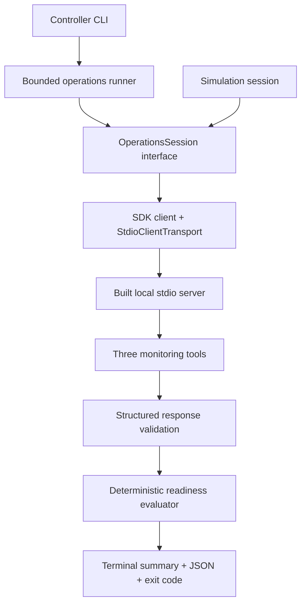

# Lab 4A: MCP operations controller

## Objectives

Build a small TypeScript client that discovers a local MCP server, validates
three monitoring results, and produces a deterministic deployment-readiness
report. Learn to distinguish an unhealthy measurement from an incomplete or
failed assessment. This controller checks capacity; it does not deploy anything.

## Prerequisites

Complete [Lab 2](lab-02-devops-monitoring.md) and understand the default-off write
policy in [Lab 3](lab-03-mcp-security.md). Use Node.js 24, installed dependencies,
and a successful build. Run commands from the repository root.

The inspected client and server SDKs are both `2.4.0`. The code uses
`@modelcontextprotocol/client` and `@modelcontextprotocol/client/stdio`, rather
than import paths from the older combined SDK package.

## Architecture



The controller owns its stdio child. It launches the built `dist/index.js` with
the current Node executable, a fixed project-root working directory, and no
note-write flag. Discovery can see the server's six tools, but the controller
can invoke only the three names in its explicit allowlist. It never calls
`write_lab_note`.

## Implementation

| Source | Responsibility |
| --- | --- |
| [controller/cli.ts](../src/controller/cli.ts) | Arguments, signals, output streams, and process exit code. |
| [controller/stdio.ts](../src/controller/stdio.ts) | SDK connection, discovery, calls, error translation, and confirmed child cleanup. |
| [controller/model.ts](../src/controller/model.ts) | Session interface, allowlist, report types, thresholds, and safe errors. |
| [controller/evaluator.ts](../src/controller/evaluator.ts) | Runtime result validation and readiness authority. |
| [controller/runner.ts](../src/controller/runner.ts) | Sequencing, discovery gate, deadline, and cleanup. |
| [controller/reporting.ts](../src/controller/reporting.ts) | Readable terminal output and JSON serialization. |
| [controller/simulation.ts](../src/controller/simulation.ts) | Deterministic sessions without OS reads or child processes. |

### Initialization and discovery

For stdio, SDK `Client.connect` performs `initialize` and
`notifications/initialized`. `listTools` then discovers the advertised tools;
SDK pagination is bounded to 16 pages. The runner requires exactly one discovery
entry for each allowed name before making any call. A missing or duplicate
required tool stops collection with a discovery failure. Extra server tools do
not become controller permissions.

Exact allowlist from [controller/model.ts](../src/controller/model.ts):

```ts
export const ALLOWED_TOOLS = Object.freeze(["system_info", "memory_usage", "disk_usage"] as const);
```

The session checks the name again at runtime and supplies `{}` as arguments.
The operations run has a 15-second deadline; individual SDK operations have
5-second timeouts. These are bounded waits, not retry loops.

### Structured output validation

The evaluator reads `structuredContent`, never metrics extracted from readable
tool text. `isError: true` is a tool failure even if other fields look usable.
The SDK also validates declared output schemas; some malformed responses can
therefore fail at the SDK protocol boundary before reaching local validation.

Local Zod schemas require the actual server fields. Byte counts must be
nonnegative safe integers, percentages finite and in `[0, 100]`, and accounting
must agree: used cannot exceed total, memory used equals total minus free, disk
available cannot exceed total minus used, and the percentage must match
`used / total * 100` within `1e-7`.

`system_info` must contain valid nonempty identity strings, but the report keeps
only its validation state. Memory and disk reports project numeric fields
explicitly. Hostnames, kernel/runtime identity, disk paths, extra fields, and raw
tool text are omitted. Zero capacity is a valid server reading with a zero
percentage, but gives an **unknown** controller check because readiness cannot
be inferred from that capacity.

### Metrics and readiness policy

The evaluator uses the server's metrics, not an application-memory estimate or
a substituted disk formula:

| Metric | Actual calculation | Interpretation |
| --- | --- | --- |
| Memory used | `os.totalmem() - os.freemem()` | Includes reclaimable Linux caches/buffers; not Linux `MemAvailable` or process-only memory. |
| Memory utilization | `usedBytes / totalBytes * 100` | Snapshot of the OS-reported capacity. |
| Disk total | `blocks * bsize` | Filesystem containing the server's working directory. |
| Disk used | `(blocks - bfree) * bsize` | Excludes all free blocks, including reserved free blocks. |
| Disk available | `max(0, bavail) * bsize` | Free space available to an unprivileged user. |
| Disk utilization | `usedBytes / totalBytes * 100` | Can differ from `df` and from `1 - available / total`; not directory size or quota. |

See [monitoring.ts](../src/monitoring.ts) for the collectors. Containers and OS
APIs may report resources differently from the limits applied to a workload.

Exact thresholds from [controller/model.ts](../src/controller/model.ts):

```ts
export const THRESHOLDS = Object.freeze({ warningPercent: 75, criticalPercent: 90 });
```

| State | Rule | Exit code |
| --- | --- | --- |
| Healthy | Complete valid checks, both utilization values below 75%. | `0` |
| Warning | Complete valid checks, at least one value >=75% and neither >=90%. | `0` |
| Critical | Complete valid checks, at least one value >=90%. | `1` |
| Unknown | Missing/duplicate checks, unknown check, or any recorded failure. | `2` |

Comparisons use unrounded percentages; terminal display rounds to two decimals.
A critical measurement means a known threshold breach. Unknown means the whole
assessment is not trustworthy or complete. **Unknown takes precedence over
critical**: a critical disk reading plus an invalid memory reading yields overall
unknown, while the valid disk check remains visible as critical.

### Errors, reporting, and cleanup

| Failure kind | Meaning and handling |
| --- | --- |
| `tool` | MCP result has `isError: true`; record the failure and attempt other tools. |
| `validation` | Result fails SDK/local output validation; record and continue where possible. |
| `protocol` | SDK rejects a protocol response; record separately from a tool error. |
| `discovery` | Required discovery contract is unavailable; do not start tool calls. |
| `transport` | Connection, request transport, or disconnect failure; stop collection. |
| `execution`, `cancelled`, `cleanup` | Execution failure, signal/deadline cancellation, or unconfirmed shutdown; assessment becomes unknown. |

Messages come from a fixed safe vocabulary. JSON includes `version`, `source`,
`state`, `exitCode`, thresholds, metric definitions, checks, and failures. The
readable summary goes to stderr; JSON goes to stdout. `--json` suppresses the
summary. The CLI writes no report file itself.

The runner closes the session in `finally`, including failed initialization and
discovery. Close is idempotent. The stdio wrapper supplements SDK stdin closure,
SIGTERM, and SIGKILL escalation by waiting for confirmed child closure. Cleanup
failure is reported, rather than presenting an unconfirmed shutdown as success.
SIGINT/SIGTERM cancel the run and use the same cleanup path.

## Commands

Build first, then run the controller against the real local server:

```sh
npm run build
node dist/controller/cli.js
node dist/controller/cli.js --json
```

The controller starts and closes its own server; do not start `npm start` in
another terminal for this workflow. `npm run controller -- --json` is also
supported, but use direct Node or `npm --silent run controller -- --json` when
stdout must contain JSON without npm's script banner.

### Simulation fixtures

```sh
node dist/controller/cli.js --simulate high-memory
node dist/controller/cli.js --simulate critical-disk
printf 'exit=%s\n' "$?"
node dist/controller/cli.js --simulate malformed-output --json
printf 'exit=%s\n' "$?"
```

`printf` must immediately follow the command whose status you want to inspect.
These modes create no hardware load, child process, or filesystem writes:

| Mode | Expected state | Exit | Injected condition |
| --- | --- | --- | --- |
| `healthy` | Healthy | `0` | Memory and disk both 50%. |
| `high-memory` | Warning | `0` | Memory 80%. |
| `critical-disk` | Critical | `1` | Disk 95%. |
| `malformed-output` | Unknown | `2` | Invalid memory field type. |
| `missing-tools` | Unknown | `2` | Disk tool absent from discovery. |
| `transport-failure` | Unknown | `2` | Connection fails. |
| `tool-error` | Unknown | `2` | Memory tool returns an MCP tool error. |

## Verification

The completed **Lab 4A stage passed 56 tests**, with typecheck, build, and
`git diff --check` passing in its implementation session. This is historical
stage evidence; the later suite includes additional Lab 4B/4C tests.

Focused coverage is in [controller.test.mjs](../test/controller.test.mjs),
[controller-stdio.test.mjs](../test/controller-stdio.test.mjs), and
[controller-cli.test.mjs](../test/controller-cli.test.mjs): thresholds and
accounting, missing/duplicate discovery, allowlisting, malformed results,
tool versus transport errors, deadlines, safe reports, simulations, and child
cleanup, including a child that resists normal termination.

To repeat the project checks in a permitted local environment:

```sh
npm run typecheck
npm run build
npm test
git diff --check
```

No application tests were rerun for this documentation-only change. See the
[shared verification record](README.md#verification) for execution-environment
limits and later milestones.

## Troubleshooting

- Missing tools: rebuild and confirm the intended checkout; a stale Lab 1 server
  cannot meet this discovery contract.
- Exit `2`: inspect safe failure kinds and per-tool checks; do not relabel it
  critical merely because another metric crossed a threshold.
- Unexpected utilization: compare formulas and working directories before
  comparing snapshots from different commands.
- Invalid JSON when piping npm output: use direct Node, `--json`, and separate
  stderr. Saving output is an explicit shell action; keep generated files private.

See [controller troubleshooting](troubleshooting.md#controller-readiness-and-exit-codes).

## Security

The allowlist is enforced in code, not by tool descriptions. The fixed child
command enables no note writes and accepts no user-selected executable or path.
Successful raw MCP monitoring output still contains local identity/path data;
the controller's projection is the reporting boundary. No credentials or raw
exceptions belong in reports. This is a trusted local process arrangement,
without authentication or OS sandboxing supplied by the controller.

## DevOps relevance

Explicit readiness policy gives scripts a stable decision interface: warning is
advisory, critical blocks with `1`, and incomplete execution is distinguishable
with `2`. Deterministic fixtures let an operator test these branches without
filling a disk or allocating memory. The session interface and evaluator can be
reused by an orchestrator and another transport, as Labs 4B and 4C demonstrate.

## Limitations

One snapshot and two capacity thresholds do not establish application readiness,
SLO compliance, resource history, container limits, or deployment safety. A
validated `system_info` check establishes response shape, not OS suitability.
No deployment, remediation, persistence, alerting service, or production
availability guarantee is implemented.

## Lessons learned

Discover before calling, validate structured data before evaluating it, and keep
measurement policy independent from display formatting. Preserve uncertainty
explicitly and treat cleanup as part of successful execution.
