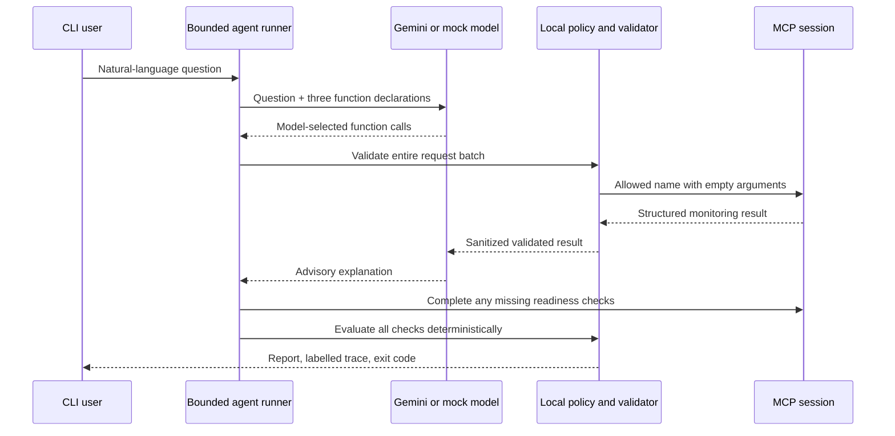

# Lab 4B: AI agent orchestration

## Objectives

Use Gemini to select read-only MCP tools from a natural-language question while
retaining [Lab 4A's deterministic readiness authority](lab-04a-mcp-operations-controller.md).
Keep model planning, tool permissions, validated results, and exit policy as
separate concerns. Provide an offline mode that exercises the same boundaries.

## Prerequisites

Complete Lab 4A, use Node.js 24, and build the project. The installed official
`@google/genai` SDK is `3.4.0`; its Node requirement is >=22. Live use requires
`GEMINI_API_KEY` exported in the environment. Mock use needs no key or Google
network connection. Nothing loads `.env` automatically.

## Architecture



The real model selects functions through the Gemini API; the live path does not
choose tools by matching words in the question. The offline model instead emits
fixed requests so its behavior is repeatable. Both paths reuse the same MCP
session, discovery gate, result validation, and evaluator.

## Implementation

| Source | Responsibility |
| --- | --- |
| [agent/gemini.ts](../src/agent/gemini.ts) | Official SDK configuration, metadata check, function declarations, conversation replay, and safe API errors. |
| [agent/model.ts](../src/agent/model.ts) | Request/result contracts, limits, trace types, bounded calls, and text redaction. |
| [agent/runner.ts](../src/agent/runner.ts) | Planning loop, policy enforcement, MCP calls, readiness completion, and cleanup. |
| [agent/mock.ts](../src/agent/mock.ts) | Deterministic model fixtures. |
| [agent/cli.ts](../src/agent/cli.ts) | Live/mock configuration, question parsing, reports, and signals. |

### Official SDK and function calls

`GoogleGenAI` uses the installed typed `models.get` and
`models.generateContent` APIs. It does not use the older
`getGenerativeModel` interface. The live adapter first checks that the exact
selected model's metadata advertises `generateContent`, then sends function
declarations for only `system_info`, `memory_usage`, and `disk_usage`.

Each declaration has an empty-object argument schema with no extra properties.
Automatic SDK function execution is disabled: the application inspects model
requests before MCP invocation. Function-calling mode is `AUTO`; the model may
answer without requesting a tool. Response IDs and opaque thought signatures
are preserved in memory for valid conversation replay and cleared on close;
they are not printed or serialized into reports.

### Permission and sanitization boundaries

Before executing any call in a batch, the runner validates the whole batch:
the requested name must be allowlisted, and arguments must be `{}` or omitted.
Paths, shell commands, arbitrary properties, unknown names, and
`write_lab_note` are rejected. A denied write request never reaches MCP.
Neither model instructions nor tool annotations can expand these permissions.

Results go through Lab 4A's structured validation and then a strict model-result
schema. The model receives validated state and numeric memory/disk metrics,
with safe tool-error classifications where applicable. It receives no raw MCP
text, hostname, platform/kernel/runtime identity, disk path, credentials, or
internal exception messages. Static function descriptions are supplied locally;
raw server descriptions do not become model instructions.

Prompts and opaque conversation history are absent from reports. Known API keys
and common credential patterns are redacted from question/advisory text, and
text length/control characters are bounded. This is not a general secret
detector: never put credentials or sensitive operational context in a question.
Live questions and sanitized results are sent to Google's API.

### Limits and readiness authority

Exact limits from [agent/model.ts](../src/agent/model.ts):

```ts
export const LIMITS = Object.freeze({ iterations: 4, toolCalls: 6, requestMs: 15_000, runMs: 60_000 });
```

The six-call budget includes deterministic completion checks. If the model
finishes after requesting only memory, the runner checks any remaining required
tools locally, budget permitting. Traces label these calls `origin: readiness`,
distinct from `origin: model` requests. The trace records allowed tool names,
turns, and outcomes; rejected names appear as `denied`, not raw model payloads.

The shared evaluator alone assigns final readiness: warning >=75%, critical
>=90%, unknown on incomplete/failed execution. Exit codes remain `0` for
healthy/warning, `1` for critical, and `2` for unknown. Model text is advisory;
an optimistic explanation cannot override a critical measurement. A model error
also makes the assessment unknown, even if some readings succeeded.

The JSON report contains `model`, `readiness`, and `agent` with status, optional
advisory answer, iteration/call counts, trace, and failures. Configuration failures
use a smaller `{state, exitCode, error}` object. JSON goes to stdout; summary and
trace go to stderr unless `--json` is selected. No files are written automatically.

### Failure classification and lifecycle

| Boundary | Examples | Result |
| --- | --- | --- |
| Model configuration/API | Missing key, unavailable model, authentication, quota, timeout, API failure, invalid response. | Fixed safe `agent.failures`; no provider exception text or automatic model fallback. |
| Invalid model request | Denied tool, nonempty arguments, malformed batch. | Reject before invocation; unknown assessment. |
| MCP tool/protocol/validation | Tool `isError`, malformed response, protocol rejection. | Safe error reply where possible; retain failed check and unknown assessment. |
| MCP transport | Disconnect, unavailable server, request transport failure. | Stop collection; retain transport classification. |
| Budget/cancellation/cleanup | Repeated model calls, call limit, deadline, signal, failed close. | Controlled failure and cleanup; unknown assessment. |

HTTP `429` maps to `model_quota`, `404` to `model_unavailable`, `401/403` to
`model_auth`, and `408/504` to `model_timeout`; other provider errors, including
`503`, map to `model_api`. Local bounded-request expiry is `model_timeout`.
The live SDK is configured for one attempt, with no automatic retry, alternate
model, or billing change. The runner closes both model and session in `finally`;
stdio child cleanup reuses Lab 4A's confirmed shutdown path.

## Commands

### Offline verification

```sh
npm run build
node dist/agent/cli.js --mock all "Is this host ready for deployment?"
node dist/agent/cli.js --mock memory --simulate high-memory "Explain memory pressure"
node dist/agent/cli.js --mock all --simulate critical-disk --json "Check readiness"
printf 'exit=%s\n' "$?"
node dist/agent/cli.js --mock denied-write --simulate healthy "Check readiness"
printf 'exit=%s\n' "$?"
```

`--mock all` uses real local monitoring through stdio but no Google API.
Adding `--simulate` removes the child process and OS reads as well. Fixtures do
not change their selection based on the question. The critical-disk example
exits `1`; denied-write exits `2`, without creating a note.

Available mock fixtures are `all`, `memory`, `disk`, `system`, `sequential`,
`denied-write`, `bad-args`, `loop`, `quota`, `unavailable`, `api-failure`, and
`invalid-response`. Monitoring simulation names are listed in
[Lab 4A](lab-04a-mcp-operations-controller.md#simulation-fixtures).

### Live Gemini configuration

Use Bash to read the key without embedding it in documentation, command
arguments, or shell history:

```bash
read -r -s -p "Gemini API key: " GEMINI_API_KEY
printf '\n'
export GEMINI_API_KEY
export GEMINI_MODEL=gemini-3.5-flash-lite
node dist/agent/cli.js --check-model
node dist/agent/cli.js "Is this host ready for deployment?"
printf 'exit=%s\n' "$?"
unset GEMINI_API_KEY
```

Do not use shell tracing (`set -x`) or dump the environment. `.env` files are
ignored by Git, but this CLI expects exported variables rather than reading
those files. `GEMINI_MODEL` is configurable; the source default remains
`gemini-3.8-flash`. The example explicitly selects the model that succeeded in
the reported manual checks. There is no silent fallback from one model to another.

`--check-model` makes a metadata request without generation or MCP. Its
`available: true` result means the metadata check succeeded and the selected
model advertises generation support. It explicitly reports quota and billing
tier as unverified. It does not prove a generation request will succeed or that
the project is operating within a particular tier.

A minimal generation diagnostic separates inference from MCP orchestration:

```bash
node --input-type=module <<'JS'
import { GoogleGenAI } from "@google/genai";
import { classifyModelError } from "./dist/agent/gemini.js";

try {
  if (!process.env.GEMINI_API_KEY) throw new Error("Missing exported key");
  const ai = new GoogleGenAI({
    apiKey: process.env.GEMINI_API_KEY,
    vertexai: false,
    apiVersion: "v1beta",
    httpOptions: {
      baseUrl: "https://generativelanguage.googleapis.com",
      timeout: 15000,
      retryOptions: { attempts: 1 },
    },
  });
  const result = await ai.models.generateContent({
    model: process.env.GEMINI_MODEL ?? "gemini-3.8-flash",
    contents: "Reply with OK only.",
    config: { abortSignal: AbortSignal.timeout(15000), maxOutputTokens: 32 },
  });
  const ok = result.text?.trim() === "OK";
  console.log(ok ? "generation: OK" : "generation: unexpected response");
  process.exitCode = ok ? 0 : 2;
} catch (error) {
  const safe = classifyModelError(error);
  console.error(safe.kind, safe.message);
  process.exitCode = 2;
}
JS
```

The snippet prints a fixed diagnostic instead of raw provider objects. Re-export
the key if the earlier example's `unset` has already run. This command requires
a live API request and is not part of offline testing.

## Verification

The completed **Lab 4B stage passed 80 tests**, with typecheck, build, and
`git diff --check` passing in its implementation session. Coverage in
[agent.test.mjs](../test/agent.test.mjs),
[agent-sdk.test.mjs](../test/agent-sdk.test.mjs), and
[agent-cli.test.mjs](../test/agent-cli.test.mjs) includes allowed/denied tools,
argument rejection, whole-batch validation, sanitization, signatures and call-ID
replay, limits, readiness authority, model/API failures, and child cleanup.
Mock SDK responses test API handling without external inference.

The operator reported these manual live outcomes for this lab:

| Check | Recorded outcome | What it establishes |
| --- | --- | --- |
| `gemini-3.8-flash` live requests | Model timeout and HTTP `503` encountered. | Those requests did not complete successfully; not proof of model removal or quota exhaustion. |
| `gemini-3.5-flash-lite` minimal generation | Successful generation. | An inference request succeeded independently of MCP. |
| `gemini-3.5-flash-lite` live MCP agent | Successful invocation. | The selected model and local MCP workflow completed in that manual environment. |

These are operator-reported results, not new live requests performed during this
documentation edit. Raw request logs and exact prompts/timings were not supplied
with the report. Metadata availability and successful generation are separate
observations; neither proves future availability, project billing tier, Free
tier entitlement, or remaining quota. The source contains a dated public-pricing
reference, not a runtime billing check. No billing/quota verification is claimed.

Repeat automated checks with `npm run typecheck`, `npm run build`, `npm test`,
and `git diff --check`. See the [shared record](README.md#verification) for later
test counts. No application or live API tests were rerun for this documentation edit.

## Troubleshooting

- Metadata succeeds but generation fails: test minimal generation separately;
  distinguish model timeout, API `503`, authentication, and quota classifications.
- Model unavailable: explicitly set an accessible `GEMINI_MODEL`; the agent will
  not choose another model for you.
- A mock asks for the same tools for different questions: this is intentional
  fixture behavior, not live model selection.
- Trace includes `readiness` calls: these complete the deterministic assessment;
  they were not requested by the model.
- Missing key in a new terminal: export it in that shell; do not paste it into a
  command argument or troubleshooting log.

See [Gemini troubleshooting](troubleshooting.md#gemini-model-and-agent-failures).

## Security

Only three read-only declarations cross the model boundary. Model output remains
untrusted, validated input; it cannot enable writes, add tools, or set status.
The key is read only for live use and is never intentionally logged or reported.
Known-secret redaction supplements explicit result projection; it does not make
arbitrary user text safe to disclose. This lab supplies no authentication,
general prompt-injection defense, or isolated execution environment.

## DevOps relevance

Natural-language interaction can explain validated operational data while a
deterministic policy remains scriptable and reviewable. A labelled trace makes
model-selected evidence distinguishable from mandatory local checks. Offline
fixtures make failure handling repeatable without API access or hardware stress.

## Limitations

Live selection and prose are nondeterministic and depend on external service
availability. Four turns and six calls intentionally bound the task. No retry
policy, automatic model migration, cost accounting, billing/quota validation,
remediation, or production deployment is implemented. HTTP transport support is
described in [Lab 4C](lab-04c-streamable-http.md).

## Lessons learned

Let the model propose evidence collection, then enforce permissions and readiness
locally. Keep metadata, successful inference, valid MCP measurements, and final
assessment as separate checks. An explicit model override is observable;
an implicit paid-model fallback would not be.
