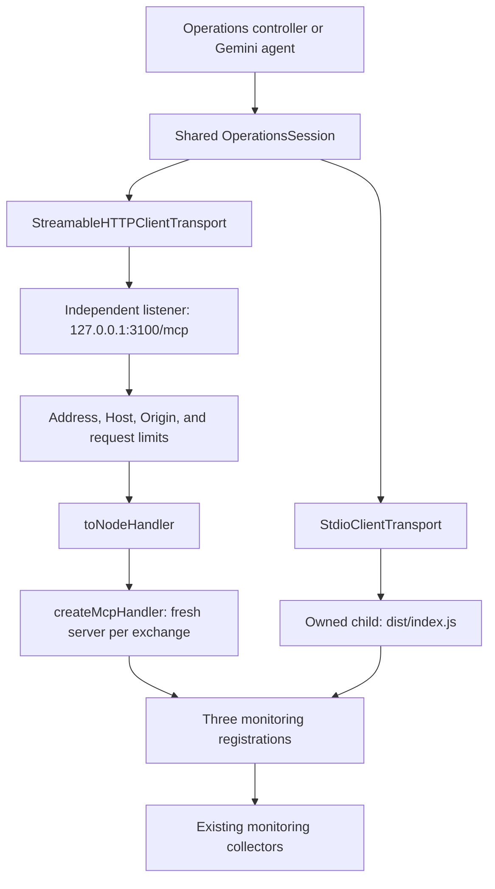

# Lab 4C: local Streamable HTTP

## Objectives

Add a separate, loopback-only MCP HTTP server and reuse the controller and agent
without changing their monitoring contracts, readiness policy, or exit codes.
Understand transport lifecycle, stateless requests, and the limited protection
provided by local address and browser-origin checks.

## Prerequisites

Complete [Lab 4A](lab-04a-mcp-operations-controller.md) and
[Lab 4B](lab-04b-ai-agent-orchestration.md). Use Node.js 24 and a successful build.
The inspected packages are `@modelcontextprotocol/server` `2.4.0`,
`@modelcontextprotocol/client` `2.4.0`, and `@modelcontextprotocol/node` `2.1.2`.
No Express application or hand-written JSON-RPC dispatcher is introduced.

## Architecture



| Property | Stdio | Local Streamable HTTP |
| --- | --- | --- |
| Server lifecycle | Client launches and owns a child process. | Operator starts an independent server. |
| Transport | Newline-delimited MCP messages on stdin/stdout. | SDK-managed MCP requests/responses over HTTP POST. |
| Tested protocol | `2025-11-25` initialization/session behavior. | Pinned `2026-07-28` stateless behavior. |
| Server tool surface | Six tools, with note writes disabled by default. | Only the three read-only monitoring tools; no note registration. |
| Client shutdown | Closes and confirms child termination. | Cancels/closes client requests; leaves the server running. |
| Disk filesystem | Controller child uses project-root working directory. | Independent server uses its own launch working directory. |

## Implementation

| Source | Responsibility |
| --- | --- |
| [http.ts](../src/http.ts) | Independent CLI startup, port argument, ready line, and signal shutdown. |
| [http-server.ts](../src/http-server.ts) | Node listener, local request guards, SDK handler factory, and teardown. |
| [http-policy.ts](../src/http-policy.ts) | Fixed host/path, protocol, limits, and strict local URL validation. |
| [controller/http.ts](../src/controller/http.ts) | Compatible SDK client transport, fetch bounds, and client close. |
| [controller/stdio.ts](../src/controller/stdio.ts) | Shared SDK session with optional pinned modern protocol. |
| [controller/cli.ts](../src/controller/cli.ts), [agent/cli.ts](../src/agent/cli.ts) | Explicit transport choice; stdio remains default. |

### SDK transport and protocol choices

`createMcpHandler` from the server v2 SDK receives a factory that creates a fresh
`McpServer` and registers only `registerMonitoringTools`. It owns MCP dispatch,
discovery, metadata/header validation, response shaping, cancellation, and
per-exchange teardown. `toNodeHandler` from `@modelcontextprotocol/node` adapts
that Web Request/Response handler to `node:http`. Body limits are applied at
both SDK boundaries. `responseMode: "auto"` leaves response encoding to the SDK;
there is no custom JSON-RPC implementation or forced legacy fallback.

The implemented July protocol is **`2026-07-28`**. The HTTP server advertises
only that version and uses `legacy: "reject"`. The HTTP client pins the same
version rather than accepting an implicit downgrade. Modern SDK discovery uses
`server/discover` and protocol metadata/headers, without a legacy
`initialize`/`notifications/initialized` session. Each POST can be handled
independently; no `Mcp-Session-Id` state is created. A long-running listener does
not imply a long-lived MCP session.

The original stdio path retains its tested **`2025-11-25`** handshake and tools
behavior. This is deliberate transport-specific compatibility, not evidence
that every historical protocol version is supported. HTTP legacy initialization
requests are rejected; the SDK can acknowledge/drop legacy notifications with
`202`, which does not establish a supported legacy session. GET, DELETE, and
OPTIONS receive `405` with `Allow: POST`; this endpoint offers no standalone
GET event stream or legacy SSE transport.

### Local endpoint restrictions

Exact policy constants from [http-policy.ts](../src/http-policy.ts):

```ts
export const HTTP_HOST = "127.0.0.1";
export const HTTP_PORT = 3100;
export const HTTP_PATH = "/mcp";
export const HTTP_PROTOCOL_VERSION = "2026-07-28";
export const HTTP_BODY_LIMIT = 64 * 1024;
export const HTTP_REQUEST_MS = 5_000;
```

- The listener binds literal IPv4 `127.0.0.1`, never a wildcard/public address.
  Both local and peer socket addresses must match it.
- A single Host header must exactly match the listener's `127.0.0.1:PORT`.
  `localhost`, alternate IP spellings, and proxy forwarding headers are rejected.
- A missing Origin is accepted for nonbrowser local clients. If present, it
  must be a single exact `http://127.0.0.1:PORT` origin. Other origins, opaque
  `null`, duplicate values, different ports/schemes, and malformed values fail.
- Only exact `/mcp` is routed; a query string or another path is not accepted.
- Request bodies are capped at 64 KiB, including chunked requests. Headers are
  capped at 8 KiB and 64 name/value pairs; excess counts are rejected rather than
  silently hiding a late Origin header.
- Requests have a 5-second absolute deadline, with bounded header/request timers
  and a 1-second keep-alive timeout. Safe failures do not echo raw exceptions.

Origin validation helps reject unwanted browser-origin requests. **Origin
validation is not authentication.** A local process can omit or forge Origin
and access this service. The endpoint has no identity, authorization, TLS,
OAuth, proxy trust, or remote-access security layer. Do not expose it through a
tunnel, reverse proxy, public bind, or port-forward as though these checks made
unauthenticated remote access safe.

### Client adapter, reuse, and cleanup

`StreamableHTTPClientTransport` is imported from
`@modelcontextprotocol/client`. The adapter reuses
`McpOperationsSession`, including tool discovery, runtime allowlisting, error
translation, and structured output validation. The evaluator and JSON schema
are unchanged; report `source` labels identify HTTP versus stdio.

Accepted client URLs are restricted to plain HTTP, literal `127.0.0.1`, an
explicit port from 1–65535, and exact `/mcp`. Credentials, DNS names, fragments,
queries, and redirects are rejected. Requests omit browser credentials, use
5-second fetch bounds, and disable reconnect retries. Client closure aborts
in-flight requests and is idempotent.

Agent HTTP support reuses this adapter with a small CLI selection; no second
model loop or evaluator was needed. Live Gemini still uses the external Google
API, whereas MCP traffic stays on local loopback. The server's SIGINT/SIGTERM
path stops acceptance, closes SDK exchanges, and closes active connections. The
HTTP client owns no server child and cannot shut down the independent listener.

## Commands

### Start the independent server

From the repository root, in terminal A:

```sh
npm run build
npm run start:http
```

Equivalent direct command: `node dist/http.js`. The ready line identifies
`http://127.0.0.1:3100/mcp` and protocol `2026-07-28`. A different local port is
explicit:

```sh
node dist/http.js --port 3101
```

Do not run both examples on the same port. There is no `--host` or note-write
option. `--port 0` selects an ephemeral port for isolated testing; use the port
printed in the ready line when connecting. HTTP disk readings follow terminal
A's working directory.

### Connect the operations controller

In terminal B, while the default-port server remains running:

```sh
node dist/controller/cli.js --transport http
node dist/controller/cli.js --transport http --url http://127.0.0.1:3100/mcp --json
printf 'exit=%s\n' "$?"
```

The first command uses the default URL. For port 3101, change `--url` to
`http://127.0.0.1:3101/mcp`. Default CLI behavior without `--transport` remains
stdio; `--url` requires HTTP. Simulations use an in-process session and cannot be
combined with HTTP transport.

### Offline and live agents over HTTP

```sh
node dist/agent/cli.js --mock all --transport http "Is this host ready for deployment?"
node dist/agent/cli.js --mock memory --transport http --json "Explain memory usage"
```

These workflows require the local HTTP server but no Gemini API key or external
network. They use live OS readings, so readiness depends on the host. For fully
deterministic metrics without a listener, use Lab 4B's mock-plus-simulation mode.

For a live model, export the key privately and select the model explicitly:

```bash
read -r -s -p "Gemini API key: " GEMINI_API_KEY
printf '\n'
export GEMINI_API_KEY
export GEMINI_MODEL=gemini-3.5-flash-lite
node dist/agent/cli.js --transport http "Is this host ready for deployment?"
printf 'exit=%s\n' "$?"
unset GEMINI_API_KEY
```

See [Lab 4B configuration](lab-04b-ai-agent-orchestration.md#live-gemini-configuration)
for metadata versus generation checks and live-service limitations.

### Verify invalid-Origin denial

With terminal A still running:

```sh
curl --noproxy '*' --max-time 5 -i \
  -X POST http://127.0.0.1:3100/mcp \
  -H 'Origin: https://untrusted.example' \
  -H 'Content-Type: application/json' \
  --data '{}'
```

Expect HTTP **403** and fixed `Origin denied.` text. The body deliberately need
not be valid MCP: Origin rejection happens before protocol handling. Ordinary
curl exits `0` for an HTTP error unless an appropriate fail option is used;
inspect the HTTP status, not the controller's exit-code policy, for this check.

### Verify controlled unavailability and shutdown

Stop terminal A with Ctrl-C, then run:

```sh
node dist/controller/cli.js --transport http --json
printf 'exit=%s\n' "$?"
```

With no other listener on 3100, expect an unknown report, transport failure, and
exit `2`. Stopping a client alone leaves terminal A running. Shutdown tests
confirm the server port can be released; manual commands should not kill an
unrelated process that happens to occupy that port.

## Verification

The completed **Lab 4C stage passed 96 tests, zero failed and zero skipped**,
with `npm run typecheck`, `npm run build`, and `git diff --check` passing in its
implementation session. The suite retains prior Labs 1–4B coverage.

[http.test.mjs](../test/http.test.mjs) and
[http-cli.test.mjs](../test/http-cli.test.mjs) use isolated ephemeral ports and
deterministic [readers](../test/fixtures/monitoring-readers.mjs) plus a
[stdio fixture server](../test/fixtures/monitoring-stdio.mjs). They cover:

- Discovery of exactly three tools, real SDK calls to all three, schema
  validation, and absence of `write_lab_note`.
- Equivalent healthy, warning, critical, malformed-output, and tool-error
  readiness results through stdio and HTTP under identical fixtures.
- Stateless modern discovery/calls, protocol metadata, version mismatch, and
  rejected legacy initialization; retained stdio behavior is tested separately.
- Invalid/multiple/late Origin and Host headers, address/proxy restrictions,
  malformed JSON, wrong methods, unsupported media types, body/header bounds,
  and safe failures.
- URL and redirect rejection, unavailable server, cancellation/timeouts,
  client close, SIGTERM server shutdown, and port release.
- Offline mock agent HTTP execution without a key, with labelled tool traces.

The implementation's manual verification recorded HTTP **403** for an invalid
Origin and a controlled transport failure with exit **2** after server shutdown.
Equivalent classifications are established with deterministic integration
fixtures; two real snapshots taken at different times need not have identical
numbers or classifications near thresholds.

The operator also reported successful **offline and live Gemini-over-HTTP**
workflows, using `gemini-3.5-flash-lite` for the live check. The live outcome is
operator-reported manual evidence, not an automated external-API test or a fresh
request during this documentation edit. It establishes that workflow's observed
success, not quota, billing tier, future availability, or all model behaviors.

Repeat project checks with:

```sh
npm run typecheck
npm run build
npm test
git diff --check
```

Runtime tests were not rerun for this documentation-only update. Earlier
restricted sandbox runs could not exercise all subprocess/network behavior;
the recorded successful full run used a permitted local environment. All HTTP
integration traffic is loopback; automated Gemini tests use mocks.

## Troubleshooting

- Transport unknown/exit `2`: start the independent server, check its printed
  port, rebuild, and use exact `http://127.0.0.1:PORT/mcp`.
- `localhost` or browser GET fails: neither is the supported CLI endpoint
  pattern. GET returning `405` is expected, not evidence of failed POST support.
- HTTP `403`: inspect Origin, exact Host/port, socket address, and proxy headers.
  Do not remove checks to accommodate an unsupported proxy.
- Legacy client fails: this HTTP endpoint requires `2026-07-28`; it deliberately
  does not downgrade to the stdio initialization protocol.
- Disk differs from stdio: compare launch directories and sampling times.
- Port stays occupied after client exit: the independent server is still running;
  stop it in its own terminal.

See [HTTP troubleshooting](troubleshooting.md#local-streamable-http).

## Security

The HTTP entry point never imports the stdio startup or registers the note tool.
No flag enables writes on it. Raw successful monitoring results still reveal
host identity and disk path to trusted local MCP clients; controller/agent
projection is a separate disclosure boundary. Loopback and Origin/Host checks
reduce exposure but do not authenticate local users or processes. Public HTTP,
forwarding, malicious local processes, and production multi-user security are
outside the implemented trust model.

## DevOps relevance

Transport independence lets the same policy assess an owned process or a
separately managed local service. Deterministic cross-transport fixtures verify
that changing delivery does not change readiness semantics. Separate shutdown
ownership prevents a client from accidentally treating an independent service
as its child.

## Limitations

Only the listed HTTP/stdio versions and local implementation paths are tested;
broader SDK compatibility is not a claim of repository support. No remote
deployment, OAuth, TLS, reverse proxy, Docker setup, reconnection recovery,
multi-client capacity benchmark, or public security review is included. OS and
filesystem portability, adversarial local-process isolation, and future model
availability are not established by these tests. Origin validation remains
distinct from authentication.

## Lessons learned

Use the installed transport APIs to own protocol behavior, then enforce the
application's smaller local policy around them. State versions, request bounds,
and lifecycle ownership explicitly. Preserve one evaluator across transports
and distinguish reproducible fixture evidence from successful live snapshots.
