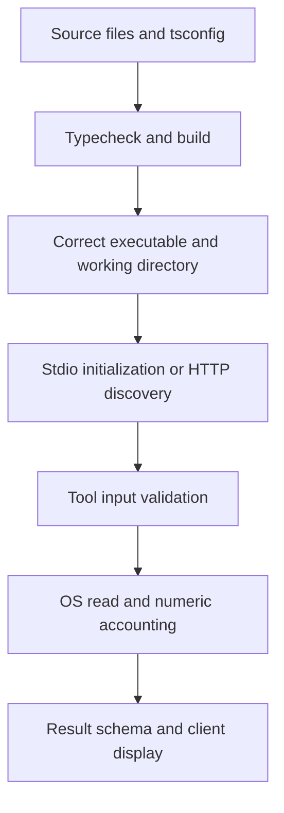

# Troubleshooting the MCP practical labs

## Objectives

Locate compiler, process, protocol, and monitoring failures using the actual
project configuration. Preserve the distinction between reported history,
observed results, proposed checks, and unverified explanations.

## Prerequisites

Use the [documented environment](README.md#prerequisites) and run commands from
the repository root. Read the current [scripts](../package.json),
[TypeScript configuration](../tsconfig.json), and relevant source before applying
a fix from another tutorial. Diagnostic commands below are suggestions, not
claims that each was executed during the documentation review.

## Architecture

Work outward from the first failing boundary:



A compiler error does not diagnose a transport failure. A generic tool failure
does not prove the process failed to start. Check which layer produced the error.

## Implementation

### TS18003: no inputs were found

**Reported experience:** the earlier lab setup encountered TS18003. Its original
diagnostic text, failing configuration, and exact corrective edit are not
retained in the inspected repository history. Do not attribute it to a specific
old path or claim it was reproduced in this documentation task.

**Meaning:** the selected TypeScript configuration found no compiler input
files. The current configuration includes `src/**/*.ts`, excludes `node_modules`
and `dist`, and uses `src` as `rootDir`. The selected source files now exist.

Check that you are in the project root, that the files are saved with `.ts`
extensions, and that the selected configuration's include/exclude rules match
them. Includes are resolved relative to the configuration file. `rootDir`
controls source-root/output relationships; it does not discover source files.
See the [TypeScript include documentation](https://www.typescriptlang.org/tsconfig/#include).

### TS2769: tool result typing

**Reported original issue:** `server_health` returned a `content` element whose
`type` was inferred as `string`, instead of the literal `"text"`. This made the
callback incompatible with the SDK's `registerTool` overloads. Mutable object
properties can widen unless a suitable context or literal assertion constrains
them.

**Observed inspection and fix:** the first inspected implementation already
used `"text" as const`. Its first recorded compiler failure was instead TS5025
for the misspelled option `noEmitOnerror`. Both handlers were then annotated
`Promise<CallToolResult>`, the local assertion was removed, and the compiler
option was corrected. Later typecheck and build passed. The initial commit
already contains the final annotations, so it is not a retained reproduction
of the original TS2769 failure.

Current import, source: [src/index.ts](../src/index.ts).

```ts
import { McpServer, type CallToolResult } from "@modelcontextprotocol/server";
```

Current health-handler signature and first statement, from the same file:

```ts
  async (): Promise<CallToolResult> => {
    const uptimeSeconds = Math.floor(process.uptime());
```

The return annotation provides the result's contextual type and validates the
content shape. Retain the real discriminator `type: "text"`; do not suppress
diagnostics with `any`, `@ts-ignore`, or relaxed strict settings.

### TS5025 and stale compiler output

Option names are case-sensitive: `noEmitOnerror` is invalid; the current setting
is `noEmitOnError: true`. The
[TypeScript option documentation](https://www.typescriptlang.org/tsconfig/#noEmitOnError)
explains that errors prevent new emission. Existing `dist` files are not removed.
A failed build followed by `npm start` can therefore run an older executable.
Confirm a successful build before interpreting discovery or runtime behavior.

### Stdio startup and discovery

`npm start` only executes the compiled server. Starting it does not send
`initialize` or a tool request. When stdin stays open, waiting for messages is
normal; when stdin closes, the process can terminate.

The startup line `MCP server connected through stdio` is written with
`console.error`, so seeing it on stderr does not itself indicate failure.
Keep free-form messages off stdout. For a host launch configuration, use the
direct `node /absolute/path/to/project/dist/index.js` command instead of a noisy
wrapper. The existing integration test uses `process.execPath` directly.

If only two tools appear, check for a stale Lab 1 build or a different checkout.
The current entry point registers six tools, including
`registerMonitoringTools(server)` and `registerNoteTool(server, notes)`, before
connecting the transport. `write_lab_note` is discoverable even when disabled.

### Sandbox subprocess failures versus local success

Earlier restricted runs failed the subprocess-based stdio test. A nested child
Node process produced empty captured output, including a trivial reproduction
that should print a value. That is the observed limitation; the exact underlying
sandbox implementation or OS policy was not established.

Running the test locally outside that sandbox succeeded. After Lab 2, the full
local suite passed six tests. Preserve both facts. Do not turn a sandbox failure
into a pass, claim the local pass proves sandbox compatibility, or weaken the
integration assertions to conceal the difference.

The focused monitoring suite uses in-memory MCP transports and can help separate
collection failures from stdio launch failures. Node's default test runner can
itself launch subprocesses; its isolation setting matters in a restricted runner.
Use a permitted local environment when end-to-end subprocess I/O is unavailable.

The completed Lab 3 implementation also passed the full local suite outside the
sandbox: 26 tests, zero failures, zero skips. An earlier sandboxed Lab 3 run
failed at the file/subprocess level. Keep those execution environments distinct.

### Monitoring results and generic errors

| Symptom | Check |
| --- | --- |
| Unexpected disk path | Client launch directory; `process.cwd()` is independent of the executable's directory. |
| Used memory looks higher than application usage | The formula is total minus free and includes reclaimable Linux caches. |
| Disk used plus available is below total | Reserved free blocks can be in `bfree` but absent from `bavail`. |
| Percentage differs from another utility | Compare formulas, units, sampling time, filesystem, and container view. |
| Available disk space is zero | `bavail` may be zero or negative; negative availability is clamped to zero. |
| Fixed `Unable to read ...` response | Check local OS support, permissions, working directory validity, and numeric constraints. |
| Extra `path` argument fails | Expected: monitoring tools reject every input property. |
| A raw collector throws in a unit test | Expected for invalid readings; the registration wrapper converts exceptions into safe MCP errors. |

The implementation rejects invalid block relationships and unsafe byte counts.
It is not a quota inspector or container-limit calculator. Do not return internal
exceptions to the caller as a debugging shortcut.

### Lab 3 startup, permissions, and audits

| Symptom | Check |
| --- | --- |
| `Note writes are disabled` | Restart the **server process** with the separate argument `--enable-note-writes`; it is not an MCP tool argument or an Inspector policy setting. |
| Generic startup failure when enabling writes | Linux and an allowlisted local filesystem; canonical working directory; trusted ancestor ownership/modes; private directory types/modes; existing note entries; writer lock. |
| Working directory differs from expectation | Note storage is fixed beneath the server's launch directory. An absolute script path does not choose that directory. |
| Enabled server fails only in a container | Overlay, FUSE, and network filesystems are deliberately not allowlisted. Do not silently bypass the check. |
| Unknown `path` or `filename` input rejected | Expected: only `content` is accepted. Invalid arguments get a safe validation denial and an outcome audit when the audit sink works. |
| Character count appears valid but input fails | Limits are 1–8192 UTF-8 bytes; malformed surrogate pairs, NUL, and unsupported controls are rejected. |
| Queue busy or quota reached | Write capacity is bounded at 16 accepted operations, including the running operation; cumulative note content is capped at 10 MiB. |
| Required auditing unavailable | Further writes are refused. Audit-file ownership/mode/link checks, writes, sync, and backlog can fail closed. |
| Note created but completion audit unconfirmed | The note may exist. Preserve the operation ID and inspect locally; do not retry automatically. |
| Cleanup could not be confirmed | A partial note may remain; further writes stop. Inspect before recovery. |
| `.note-writer.lock` remains after a crash | A second writer or stale lock blocks initialization. Verify no writer is alive and inspect storage before any operator-controlled recovery; there is no automatic stale-lock removal. |

Use the [Lab 3 Inspector setup](lab-03-mcp-security.md#mcp-inspector-setup) to
separate command, argument tokens, and tool arguments. Do not insert a bare `--`
into the server's actual argument array: its startup parser accepts only zero
arguments or the single exact enable flag. Inspector's own separator handling is
a separate concern. Follow [manual verification](lab-03-mcp-security.md#manual-verification)
for read-only permission/audit inspection; do not broadly chmod existing data or
delete locks merely to obtain a passing result.

### Controller readiness and exit codes

| Symptom | Check |
| --- | --- |
| Exit `1` | At least one valid utilization check is >=90%, with a complete assessment. This is critical, not a transport failure. |
| Exit `2` despite a critical disk check | Any failed/missing/unknown check makes the overall assessment unknown. Read the per-tool checks and safe failure kinds. |
| Exit `0` with a warning | Expected: warning starts at 75% and remains advisory. Thresholds use unrounded percentages. |
| Missing/duplicate required tool | Rebuild and verify the intended server; no tool calls start until discovery passes. |
| Malformed tool response | Structured output is required. The SDK can reject the response before local validation; raw text is never used as replacement metrics. |
| JSON parser sees npm output | Use direct `node dist/controller/cli.js --json` or npm `--silent`; keep stderr separate. |
| Hanging/stale child | The stdio close path confirms child termination. Preserve a reported cleanup failure; do not label it healthy. |

Use [Lab 4A simulations](lab-04a-mcp-operations-controller.md#simulation-fixtures)
to reproduce warning, critical, malformed output, missing tools, transport
failure, and tool failure without loading real hardware. A tool `isError`
response is not the same as failure to connect or communicate with the server.

### Gemini model and agent failures

| Symptom | Check |
| --- | --- |
| Configuration failure | Export `GEMINI_API_KEY` in the current shell; `.env` is not loaded. Confirm a valid `GEMINI_MODEL` value. Never print the key. |
| `--check-model` succeeds but generation fails | Metadata availability is a separate check, not proof of inference success, quota, or billing tier. |
| `model_timeout` | The bounded model request expired (15 seconds), or the provider returned 408/504. The agent does not automatically retry or change models. |
| HTTP 503 from Gemini | Classified as `model_api`, with a fixed message; not automatically classified as a quota failure. |
| HTTP 429 / 404 / 401 or 403 from Gemini | Classified as `model_quota` / `model_unavailable` / `model_auth`, respectively. These provider codes differ from a local MCP HTTP denial. |
| Denied tool or argument | Expected policy rejection for writes, unknown names, or nonempty arguments; do not expand permissions to satisfy a model. |
| Loop or call limit | Four model turns and six total MCP calls are bounded, including local completion checks. Use a narrower question or inspect a deterministic mock. |
| Trace shows `readiness` | The local runner completed required checks after the model finished. These were not model-selected calls. |

The reported `gemini-3.8-flash` live attempts encountered a timeout and HTTP 503.
The operator subsequently reported successful minimal generation and a live MCP
agent invocation with explicit `GEMINI_MODEL=gemini-3.5-flash-lite`, including
live HTTP use in Lab 4C. These manual outcomes do not establish future service
availability, Free tier entitlement, billing, or quota. No automatic fallback
occurred. See [Lab 4B](lab-04b-ai-agent-orchestration.md#verification) for the
recorded scope and [private configuration commands](lab-04b-ai-agent-orchestration.md#live-gemini-configuration).

### Local Streamable HTTP

| Symptom | Check |
| --- | --- |
| Unknown transport result / exit `2` | Start `npm run start:http` separately; verify the ready line, port, and exact `/mcp` URL. |
| `localhost`, remote URL, query, or redirect rejected | The client accepts only literal `http://127.0.0.1:PORT/mcp`, with an explicit port and no redirect. |
| Local HTTP `403` | Check exact Host, supplied Origin, loopback addresses, duplicate headers, and proxy headers. Origin must match the server's actual port if present. |
| GET `/mcp` returns `405` | Expected. This endpoint is POST-only, not a browser page or standalone GET stream. |
| Legacy initialization rejected | HTTP pins `2026-07-28` and rejects legacy sessions; stdio retains tested `2025-11-25` behavior. Use the compatible SDK adapter. |
| `413`, `431`, or timeout | Request body limit is 64 KiB, header limit 8 KiB/64 pairs, deadline 5 seconds. Do not remove limits for malformed clients. |
| Different stdio and HTTP disk values | HTTP uses its independently launched server's working directory; stdio uses the project root. Compare filesystem and sampling time. |
| Port remains occupied after client finishes | The HTTP server has an independent lifecycle. Stop it with Ctrl-C in its own terminal. |

Use [Lab 4C's denial and shutdown commands](lab-04c-streamable-http.md#verify-invalid-origin-denial).
Origin validation is not authentication. Do not remove guards, bind publicly, or
introduce forwarding to work around this intentionally local endpoint policy.
For reproducible metrics use the isolated-port fixture tests; real snapshots can
change between calls.

## Commands

Run these checks individually so the first failure remains visible:

```sh
node --version
npm ls --depth=0
npm exec -- tsc --showConfig
npm exec -- tsc --listFilesOnly
npm run typecheck
npm run build
npm test
```

The first two inspect the runtime and installed packages. `--showConfig` shows
effective compiler configuration; `--listFilesOnly` helps confirm selected files.
The last three check source, compile, and run the full suite.

To isolate monitoring after a successful build:

```sh
node --test --test-isolation=none test/monitoring.test.mjs
```

This requests a focused in-process test run on the Node.js 24 baseline. It does
not validate the production stdio transport and is not a substitute for the full
suite. For optional manual protocol inspection, follow the
[Inspector instructions](lab-01-mcp-fundamentals.md#optional-mcp-inspector).

## Verification

The earlier successful local `npm test` run reported these six cases:

1. MCP stdio discovery, tool calls, and input validation.
2. Monitoring tools advertise schemas and return real structured snapshots.
3. Memory calculation handles zero capacity and rejects invalid readings.
4. Disk accounting distinguishes reserved free blocks from used blocks.
5. Monitoring failures return safe MCP errors without host details.
6. Monitoring tools reject client paths before reading the host.

The names and assertions can be checked in [test/mcp.test.mjs](../test/mcp.test.mjs)
and [test/monitoring.test.mjs](../test/monitoring.test.mjs). This is recorded prior
evidence, not a newly executed documentation-task test run. The
[shared verification record](README.md#verification) also records the earlier
sandbox failure, successful typecheck/build, and unverified Inspector workflow.

Those six cases describe the Lab 2 milestone. Lab 3 extends the full suite to
26 passing tests with no failures or skips in its recorded local run, including
[note-service tests](../test/lab-notes.test.mjs) and
[enabled stdio testing](../test/note-stdio.test.mjs). See
[Lab 3 automated verification](lab-03-mcp-security.md#automated-verification).
Later recorded stage totals were **56 passing tests for Lab 4A**, **80 for
Lab 4B**, and **96 for Lab 4C**, with typecheck, build, and whitespace checks
passing at those milestones. HTTP tests use isolated loopback ports and injected
readings; automated Gemini tests use mocks. Live model/HTTP outcomes are recorded
separately in the [shared record](README.md#verification).
No runtime tests were rerun for this documentation-only update.

## Troubleshooting

For a useful issue report, capture the command, working directory, runtime and
package versions, exit status, first diagnostic, and execution environment.
Separate protocol stdout from diagnostics. Redact host paths, tokens, and other
unnecessary metadata before sharing logs.

## Security

Diagnose from the same intended working directory and OS account. A failure is
not a reason to add arbitrary path inputs, shell execution, or broad privileges.
The [security guide](concepts/security-fundamentals.md) describes the existing
boundaries and intentional disclosures.

## DevOps relevance

Reproducible failures need environment context. Compiler selection, emitted
artifacts, process streams, and metric definitions can each explain different
symptoms. Record evidence at the failing layer before proposing remediation.

## Lessons learned

Keep historical reports explicit about missing evidence. Correct typing and
configuration at their source. State the limits of each test environment, and
avoid changing security boundaries merely to obtain a green result.
