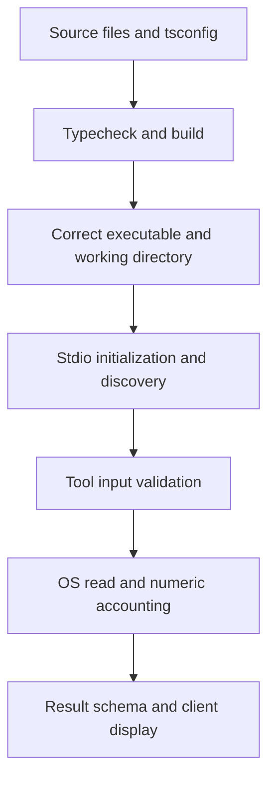

# Troubleshooting the MCP practical labs

## Objectives

Locate compiler, process, protocol, and monitoring failures using the actual
project configuration. Preserve the distinction between reported history,
observed results, proposed checks, and unverified explanations.

## Prerequisites

Use the [documented environment](README.md#prerequisites) and run commands from
the repository root. Read the current [scripts](../package.json),
[TypeScript configuration](../tsconfig.json), and relevant source before applying
a fix from another tutorial. Diagnostic commands below are suggestions, not
claims that each was executed during the documentation review.

## Architecture

Work outward from the first failing boundary:



A compiler error does not diagnose a transport failure. A generic tool failure
does not prove the process failed to start. Check which layer produced the error.

## Implementation

### TS18003: no inputs were found

**Reported experience:** the earlier lab setup encountered TS18003. Its original
diagnostic text, failing configuration, and exact corrective edit are not
retained in the inspected repository history. Do not attribute it to a specific
old path or claim it was reproduced in this documentation task.

**Meaning:** the selected TypeScript configuration found no compiler input
files. The current configuration includes `src/**/*.ts`, excludes `node_modules`
and `dist`, and uses `src` as `rootDir`. The selected source files now exist.

Check that you are in the project root, that the files are saved with `.ts`
extensions, and that the selected configuration's include/exclude rules match
them. Includes are resolved relative to the configuration file. `rootDir`
controls source-root/output relationships; it does not discover source files.
See the [TypeScript include documentation](https://www.typescriptlang.org/tsconfig/#include).

### TS2769: tool result typing

**Reported original issue:** `server_health` returned a `content` element whose
`type` was inferred as `string`, instead of the literal `"text"`. This made the
callback incompatible with the SDK's `registerTool` overloads. Mutable object
properties can widen unless a suitable context or literal assertion constrains
them.

**Observed inspection and fix:** the first inspected implementation already
used `"text" as const`. Its first recorded compiler failure was instead TS5025
for the misspelled option `noEmitOnerror`. Both handlers were then annotated
`Promise<CallToolResult>`, the local assertion was removed, and the compiler
option was corrected. Later typecheck and build passed. The initial commit
already contains the final annotations, so it is not a retained reproduction
of the original TS2769 failure.

Current import, source: [src/index.ts](../src/index.ts).

```ts
import { McpServer, type CallToolResult } from "@modelcontextprotocol/server";
```

Current health-handler signature and first statement, from the same file:

```ts
  async (): Promise<CallToolResult> => {
    const uptimeSeconds = Math.floor(process.uptime());
```

The return annotation provides the result's contextual type and validates the
content shape. Retain the real discriminator `type: "text"`; do not suppress
diagnostics with `any`, `@ts-ignore`, or relaxed strict settings.

### TS5025 and stale compiler output

Option names are case-sensitive: `noEmitOnerror` is invalid; the current setting
is `noEmitOnError: true`. The
[TypeScript option documentation](https://www.typescriptlang.org/tsconfig/#noEmitOnError)
explains that errors prevent new emission. Existing `dist` files are not removed.
A failed build followed by `npm start` can therefore run an older executable.
Confirm a successful build before interpreting discovery or runtime behavior.

### Stdio startup and discovery

`npm start` only executes the compiled server. Starting it does not send
`initialize` or a tool request. When stdin stays open, waiting for messages is
normal; when stdin closes, the process can terminate.

The startup line `MCP server connected through stdio` is written with
`console.error`, so seeing it on stderr does not itself indicate failure.
Keep free-form messages off stdout. For a host launch configuration, use the
direct `node /absolute/path/to/project/dist/index.js` command instead of a noisy
wrapper. The existing integration test uses `process.execPath` directly.

If only two tools appear, check for a stale Lab 1 build or a different checkout.
The current entry point registers all five tools, including
`registerMonitoringTools(server)`, before connecting the transport.

### Sandbox subprocess failures versus local success

Earlier restricted runs failed the subprocess-based stdio test. A nested child
Node process produced empty captured output, including a trivial reproduction
that should print a value. That is the observed limitation; the exact underlying
sandbox implementation or OS policy was not established.

Running the test locally outside that sandbox succeeded. After Lab 2, the full
local suite passed six tests. Preserve both facts. Do not turn a sandbox failure
into a pass, claim the local pass proves sandbox compatibility, or weaken the
integration assertions to conceal the difference.

The focused monitoring suite uses in-memory MCP transports and can help separate
collection failures from stdio launch failures. Node's default test runner can
itself launch subprocesses; its isolation setting matters in a restricted runner.
Use a permitted local environment when end-to-end subprocess I/O is unavailable.

### Monitoring results and generic errors

| Symptom | Check |
| --- | --- |
| Unexpected disk path | Client launch directory; `process.cwd()` is independent of the executable's directory. |
| Used memory looks higher than application usage | The formula is total minus free and includes reclaimable Linux caches. |
| Disk used plus available is below total | Reserved free blocks can be in `bfree` but absent from `bavail`. |
| Percentage differs from another utility | Compare formulas, units, sampling time, filesystem, and container view. |
| Available disk space is zero | `bavail` may be zero or negative; negative availability is clamped to zero. |
| Fixed `Unable to read ...` response | Check local OS support, permissions, working directory validity, and numeric constraints. |
| Extra `path` argument fails | Expected: monitoring tools reject every input property. |
| A raw collector throws in a unit test | Expected for invalid readings; the registration wrapper converts exceptions into safe MCP errors. |

The implementation rejects invalid block relationships and unsafe byte counts.
It is not a quota inspector or container-limit calculator. Do not return internal
exceptions to the caller as a debugging shortcut.

## Commands

Run these checks individually so the first failure remains visible:

```sh
node --version
npm ls --depth=0
npm exec -- tsc --showConfig
npm exec -- tsc --listFilesOnly
npm run typecheck
npm run build
npm test
```

The first two inspect the runtime and installed packages. `--showConfig` shows
effective compiler configuration; `--listFilesOnly` helps confirm selected files.
The last three check source, compile, and run the full suite.

To isolate monitoring after a successful build:

```sh
node --test --test-isolation=none test/monitoring.test.mjs
```

This requests a focused in-process test run on the Node.js 24 baseline. It does
not validate the production stdio transport and is not a substitute for the full
suite. For optional manual protocol inspection, follow the
[Inspector instructions](lab-01-mcp-fundamentals.md#optional-mcp-inspector).

## Verification

The earlier successful local `npm test` run reported these six cases:

1. MCP stdio discovery, tool calls, and input validation.
2. Monitoring tools advertise schemas and return real structured snapshots.
3. Memory calculation handles zero capacity and rejects invalid readings.
4. Disk accounting distinguishes reserved free blocks from used blocks.
5. Monitoring failures return safe MCP errors without host details.
6. Monitoring tools reject client paths before reading the host.

The names and assertions can be checked in [test/mcp.test.mjs](../test/mcp.test.mjs)
and [test/monitoring.test.mjs](../test/monitoring.test.mjs). This is recorded prior
evidence, not a newly executed documentation-task test run. The
[shared verification record](README.md#verification) also records the earlier
sandbox failure, successful typecheck/build, and unverified Inspector workflow.

## Troubleshooting

For a useful issue report, capture the command, working directory, runtime and
package versions, exit status, first diagnostic, and execution environment.
Separate protocol stdout from diagnostics. Redact host paths, tokens, and other
unnecessary metadata before sharing logs.

## Security

Diagnose from the same intended working directory and OS account. A failure is
not a reason to add arbitrary path inputs, shell execution, or broad privileges.
The [security guide](concepts/security-fundamentals.md) describes the existing
boundaries and intentional disclosures.

## DevOps relevance

Reproducible failures need environment context. Compiler selection, emitted
artifacts, process streams, and metric definitions can each explain different
symptoms. Record evidence at the failing layer before proposing remediation.

## Lessons learned

Keep historical reports explicit about missing evidence. Correct typing and
configuration at their source. State the limits of each test environment, and
avoid changing security boundaries merely to obtain a green result.
